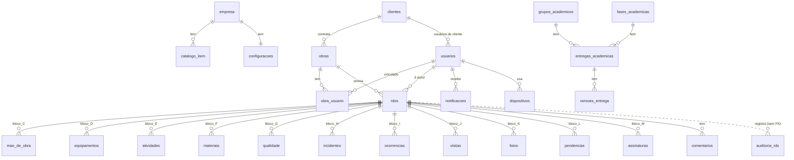

# Banco de dados — RDO Mobile

Documentação do banco no **Supabase (PostgreSQL)**, para quem vai implementar as rotas do back-end.

- Schema: [`server/sql/schema.sql`](../server/sql/schema.sql) · Dados de demonstração: [`server/sql/seed.sql`](../server/sql/seed.sql)
- Base: [`modelo-de-dados.md`](modelo-de-dados.md) (campos e decisões) e a seção 2 de [`regras-de-negocio.md`](regras-de-negocio.md) (permissões)
- Contrato das rotas: [`api.md`](api.md)

**Em números:** 31 tabelas, RLS ligado em todas, 1 função de numeração, 4 gatilhos e 3 índices únicos parciais.

## Sumário

1. [Como o back-end usa o banco](#1-como-o-back-end-usa-o-banco)
2. [Convenções](#2-convenções)
3. [Atenção: 4 nomes que a conversão automática erra](#3-atenção-4-nomes-que-a-conversão-automática-erra)
4. [Relações entre as tabelas](#4-relações-entre-as-tabelas)
5. [Como a API vira tabelas](#5-como-a-api-vira-tabelas)
6. [Numeração dos RDOs](#6-numeração-dos-rdos)
7. [O que o banco garante e o que a API precisa validar](#7-o-que-o-banco-garante-e-o-que-a-api-precisa-validar)
8. [Permissões (RLS)](#8-permissões-rls)
9. [Tabelas e colunas](#9-tabelas-e-colunas)
10. [Dados de demonstração, Storage e como recriar](#10-dados-de-demonstração-storage-e-como-recriar)
11. [Configuração do projeto no Supabase](#11-configuração-do-projeto-no-supabase)
12. [Pontos em aberto](#12-pontos-em-aberto)

---

## 1. Como o back-end usa o banco

O servidor (`server/src/supabase.js`) cria dois clientes:

| Cliente | Chave          | Para quê                                               |
| ------- | -------------- | ------------------------------------------------------ |
| `db`    | `service_role` | Ler e gravar as tabelas e o Storage. **Ignora o RLS.** |
| `auth`  | `anon`         | Login com e-mail e senha no Supabase Auth.             |

Como o `db` ignora o RLS, **quem garante as permissões nas rotas é o código**: conferir o perfil (`exigirPerfil`), o vínculo do usuário com a obra (`obra_usuario`) e o status do RDO. O RLS do banco é uma segunda barreira, que vale para quem falar com o banco usando o token de um usuário. Resumo na [seção 8](#8-permissões-rls).

As chaves ficam só no `server/.env` e no painel do Render (Project Settings → API, no Supabase). **Nunca** coloque chaves no GitHub nem no grupo.

Teste de conexão: com o servidor rodando, `GET /api/v1/health` deve mostrar `"banco": "conectado"`.

---

## 2. Convenções

- **Nomes em `snake_case`** (`cliente_id`, `criado_em`). A API usa `camelCase`; a conversão está em `server/src/mapear.js` (`doBanco` e `paraBanco`).
- **A conversão é só do primeiro nível.** As chaves **dentro** das colunas `jsonb` ficam em `camelCase`, exatamente como a API devolve (`identificacao.nomeObra`, `clima.precipitacaoMm`…). Não converta o conteúdo do `jsonb`.
- **Ids são `text`.** O padrão é um uuid em texto (`gen_random_uuid()::text`), e os dados de demonstração usam ids legíveis como `u_joao` e `obra_alfa`.
- **Listas de valores** (status, turno, perfil…) são `text` com `CHECK`. Guarde sempre a **chave** (`em_analise`), nunca o rótulo em português.
- **Horas** (`hora_inicio`, `horario`, `entrada`…) usam o tipo `hora_hhmm`: texto no formato `HH:MM`, de `00:00` a `23:59`.
- **Datas** são `date` (volta como `2026-10-02`). **Data e hora** são `timestamptz`; o Supabase devolve algo como `2026-10-02T10:15:00+00:00` (em vez do `...Z` do JavaScript).
- **Números** são `integer` ou `numeric`. No contrato o app envia número JSON com ponto decimal (decisão M1 do `modelo-de-dados.md`).
- **Ordem das listas:** as tabelas filhas têm a coluna `ordem`; ordene por ela ao montar o RDO. As exceções são `ocorrencias` (ordene por `codigo`) e `fotos` (ordene por `numero`).
- **Atualização automática:** `rdos.atualizado_em` é atualizado sozinho por um gatilho a cada `update`.

---

## 3. Atenção: 4 nomes que a conversão automática erra

A conversão de `mapear.js` troca cada letra maiúscula por `_` + minúscula. Isso funciona para quase tudo, mas **4 campos da API** não batem com as colunas:

| Campo da API     | A conversão automática gera | Coluna que existe no banco | Tabela        |
| ---------------- | --------------------------- | -------------------------- | ------------- |
| `engenheiroRT`   | `engenheiro_r_t`            | `engenheiro_rt`            | `obras`       |
| `engenheiroRTId` | `engenheiro_r_t_id`         | `engenheiro_rt_id`         | `obras`       |
| `referenciaEAP`  | `referencia_e_a_p`          | `referencia_eap`           | `atividades`  |
| `metodo2fa`      | `metodo2fa`                 | `metodo_2fa`               | `assinaturas` |

Na volta (`doBanco`) o erro é o mesmo: `engenheiro_rt_id` viraria `engenheiroRtId`.

**Sugestão de correção** (pequena, só em `mapear.js`), sem mexer no banco:

```js
// Campos que a regra automática não acerta.
const ESPECIAIS = {
  engenheiroRT: 'engenheiro_rt',
  engenheiroRTId: 'engenheiro_rt_id',
  referenciaEAP: 'referencia_eap',
  metodo2fa: 'metodo_2fa',
};
const INVERSO = Object.fromEntries(Object.entries(ESPECIAIS).map(([api, banco]) => [banco, api]));

const paraCamel = (s) => INVERSO[s] ?? s.replace(/_([a-z])/g, (_, c) => c.toUpperCase());
const paraSnake = (s) => ESPECIAIS[s] ?? s.replace(/[A-Z]/g, (c) => `_${c.toLowerCase()}`);
```

Alternativa: renomear as 4 colunas no banco para os nomes que a regra gera (`engenheiro_r_t`, `engenheiro_r_t_id`, `referencia_e_a_p`, `metodo2fa`). Fica sem código extra, mas os nomes ficam feios e o `seed.sql` precisa ser ajustado junto.

---

## 4. Relações entre as tabelas



Detalhes que o desenho não mostra:

- `auditoria_rdo.rdo_id` **não tem chave estrangeira** de propósito: o registro de auditoria precisa sobreviver mesmo que o RDO seja excluído.
- `rdos` aponta para outros RDOs em `retifica_de`, `retificado_por` e `reaproveitado_de` (retificação e reaproveitamento).
- Ao apagar um RDO, os blocos C a L, as assinaturas e os comentários saem junto (`on delete cascade`). **Os arquivos das fotos no bucket não**: a API precisa apagá-los.

---

## 5. Como a API vira tabelas

O RDO da API (`docs/api.md`) é um objeto só, com listas dentro. No banco ele está espalhado. Para montar a resposta de `GET /rdos/{id}`:

| Campo do RDO na API                                                                                                  | De onde vem                                                                 |
| -------------------------------------------------------------------------------------------------------------------- | --------------------------------------------------------------------------- |
| campos simples (`numero`, `versao`, `data`, `turno`, `status`…)                                                      | colunas de `rdos`                                                           |
| `identificacao`, `clima`, `semProducao`, `planejamento`, `semRegistro`, `declaracao`, `devolucao`, `cancelamento`    | colunas `jsonb` de `rdos` (copiar como estão)                               |
| `seguranca`                                                                                                          | coluna `jsonb` `rdos.seguranca` **mais** `incidentes` (tabela `incidentes`) |
| `maoDeObra`, `equipamentos`, `atividades`, `materiais`, `qualidade`, `ocorrencias`, `visitas`, `fotos`, `pendencias` | tabelas filhas, filtradas por `rdo_id` e ordenadas por `ordem`              |
| `assinaturas` (`{ master, cliente }`)                                                                                | linhas de `assinaturas` com `papel = 'master'` e `'cliente'`                |
| `assinaturaOperacional`                                                                                              | linha de `assinaturas` com `papel = 'operacional'`                          |
| `comentarios`                                                                                                        | tabela `comentarios`                                                        |
| `auditoria`                                                                                                          | tabela `auditoria_rdo` (consulta à parte: não tem FK)                       |
| `sync`                                                                                                               | **não é guardado**: é estado do app                                         |

Para a **obra**: `clienteNome` não existe no banco (faça o join com `clientes`), e `usuarioIds` vem de `obra_usuario`.

Para as **fotos** (`fotos`):

- `vinculo` da API = `{ tipo: vinculo_tipo, id: vinculo_id }`.
- `meta` = `{ largura, altura, compressao }`, e `coordenada` = `{ latitude, longitude }`.
- `uri` é a URL da rota que entrega o arquivo (a partir de `storage_path`).
- `cor`, `icone` e `envio` são só do app (marcadores das fotos de demonstração); não existem no banco.

Exemplo de leitura com blocos aninhados (o Supabase segue as chaves estrangeiras). Não é código pronto, só uma referência:

```js
const { data: rdo, error } = await db
  .from('rdos')
  .select(
    '*, mao_de_obra(*), equipamentos(*), atividades(*), materiais(*), qualidade(*), incidentes(*), ocorrencias(*), visitas(*), fotos(*), pendencias(*), assinaturas(*), comentarios(*)',
  )
  .eq('id', id)
  .maybeSingle();
// auditoria_rdo não tem FK: buscar à parte
const { data: auditoria } = await db.from('auditoria_rdo').select('*').eq('rdo_id', id).order('data_hora');
```

---

## 6. Numeração dos RDOs

A numeração é por obra (RF-04), automática, e **o número gasto não volta**, nem se o RDO for cancelado. Use a função do banco, que trava a linha da obra e garante que dois RDOs criados ao mesmo tempo nunca recebam o mesmo número:

```js
const { data: numero, error } = await db.rpc('proximo_numero_rdo', { p_obra: obraId });
```

Depois use `numero` ao inserir o RDO. Detalhes:

- A função soma 1 em `obras.ultimo_numero_rdo` e devolve o novo valor. Só a `service_role` pode executá-la.
- A combinação `(obra_id, numero, versao)` é única. Numa retificação o `numero` é o mesmo e a `versao` sobe.
- O seed já deixa o contador de cada obra no maior número existente.

---

## 7. O que o banco garante e o que a API precisa validar

**O banco garante:**

- valores das listas (status, turno, perfil, condição…) e o formato `HH:MM`;
- hashes com 64 caracteres hexadecimais;
- `numero` único por obra e versão;
- master e cliente assinam uma única vez por RDO e versão (índice único parcial; o operacional pode assinar de novo após devolução);
- auditoria que só aceita inclusão (um gatilho bloqueia UPDATE e DELETE, até para a `service_role`);
- usuário `cliente` sempre com `cliente_id`;
- faixas simples: quantidade ≥ 1, horas entre 0 e 24, percentual entre 0 e 100;
- as permissões do [RLS](#8-permissões-rls), para acesso com token de usuário.

**A API precisa validar** (o banco não faz):

- permissões por perfil, vínculo com a obra e **transições de status** (seção 2 e fluxo do `regras-de-negocio.md`);
- as validações da **submissão** (seção 9): data não futura, justificativas, horas coerentes, campos obrigatórios dos blocos (o banco aceita rascunhos incompletos de propósito);
- **hash SHA-256**, data e hora gerados no servidor (o banco não calcula hash);
- aviso de RDO duplicado para a mesma obra, data e turno (há índice, mas não é único: é só aviso);
- `crea` obrigatório para o master (decisão M8);
- soma dos pesos dos critérios acadêmicos igual a 100;
- **upload de fotos**: tipos aceitos, tamanho e quantidade (decisão D4, ainda em aberto), e apagar o arquivo do bucket ao excluir a foto ou o RDO;
- prazos e lembretes (24 h do master, 24/48 h do cliente) e a criação das notificações;
- cancelar (RDO assinado) versus excluir (só não assinado).

---

## 8. Permissões (RLS)

Valem para acesso com o **token de um usuário**. As rotas do servidor, que usam a `service_role`, precisam repetir essas regras no código.

| Tabela                                      | Quem lê                                                                                                                                                                | Quem escreve                                                                                                                                                                     |
| ------------------------------------------- | ---------------------------------------------------------------------------------------------------------------------------------------------------------------------- | -------------------------------------------------------------------------------------------------------------------------------------------------------------------------------- |
| `empresa`, `catalogo_item`, `configuracoes` | qualquer usuário ativo                                                                                                                                                 | só master                                                                                                                                                                        |
| `clientes`                                  | master; os demais só o cliente das obras que enxergam                                                                                                                  | só master                                                                                                                                                                        |
| `usuarios`                                  | master vê todos; cada um vê o próprio                                                                                                                                  | master cria e altera; cada um edita o próprio (perfil, e-mail, cliente, `auth_id` e bloqueio são protegidos por gatilho). Não há DELETE: o usuário é bloqueado (`ativo = false`) |
| `obras`, `obra_usuario`                     | master todas; os demais só as vinculadas                                                                                                                               | só master                                                                                                                                                                        |
| `rdos`                                      | master todos; operacional os das suas obras; **cliente só os liberados** (`enviado_cliente` e `finalizado`; `retificado` e `cancelado` só se já tinham sido liberados) | operacional cria (como `rascunho`, sendo o autor) e edita o próprio em `rascunho` ou `devolvido`; master altera; excluir só master e só RDO não assinado                         |
| blocos C a L (`mao_de_obra`… `pendencias`)  | quem pode ver o RDO                                                                                                                                                    | operacional autor em `rascunho` ou `devolvido`; master em `submetido` ou `em_analise`                                                                                            |
| `assinaturas`                               | quem pode ver o RDO                                                                                                                                                    | só inclui; cada perfil assina o próprio papel e no status certo; sem UPDATE e DELETE                                                                                             |
| `comentarios`                               | quem pode ver o RDO; o cliente só os de visibilidade `cliente`                                                                                                         | só inclui; o cliente só em RDO `enviado_cliente` ou `finalizado`; sem UPDATE e DELETE                                                                                            |
| `auditoria_rdo`                             | quem pode ver o RDO; o cliente só os eventos públicos                                                                                                                  | só inclui; imutável                                                                                                                                                              |
| `auditoria_global`                          | só master                                                                                                                                                              | só inclui; imutável                                                                                                                                                              |
| `notificacoes`                              | só o destinatário                                                                                                                                                      | o destinatário marca como lida; quem cria é o servidor                                                                                                                           |
| `arquivos_exportados`                       | só master                                                                                                                                                              | só master                                                                                                                                                                        |
| `dispositivos`                              | o dono                                                                                                                                                                 | o dono                                                                                                                                                                           |
| `idempotencia`                              | ninguém (só o servidor)                                                                                                                                                | ninguém (só o servidor)                                                                                                                                                          |
| tabelas do módulo acadêmico (5)             | só master                                                                                                                                                              | só master                                                                                                                                                                        |

Eventos de auditoria que o cliente enxerga: `validacao`, `envio_cliente`, `ciencia_cliente`, `ressalva_cliente`, `esclarecimento_cliente`, `esclarecimento_respondido`, `finalizacao` e `retificacao`.

Funções de apoio (schema `privado`): `usuario_id()`, `perfil()`, `na_obra(obra)`, `rdo_liberado(status, liberado_em)`, `status_rdo(rdo)`, `pode_ver_rdo(rdo)` e `pode_editar_rdo(rdo)`.

---

## 9. Tabelas e colunas

Legenda: **Nulo?** indica se a coluna aceita valor vazio. **Padrão** é o valor usado quando a coluna não é informada no `insert`. As notas vêm dos comentários do `schema.sql`.

## Empresa, clientes e usuários

### `empresa`

Dados da empresa executora (uma linha). Alimentam o cabeçalho do PDF.

| Coluna        | Tipo   | Nulo? | Padrão      | Valores, regras e notas |
| ------------- | ------ | ----- | ----------- | ----------------------- |
| `id`          | `text` | não   | uuid gerado | chave primária          |
| `nome`        | `text` | não   |             |                         |
| `cnpj`        | `text` | não   |             |                         |
| `cidade`      | `text` | sim   |             |                         |
| `email`       | `text` | sim   |             |                         |
| `telefone`    | `text` | sim   |             |                         |
| `responsavel` | `text` | sim   |             |                         |

### `clientes`

Clientes (contratantes) das obras.

| Coluna     | Tipo   | Nulo? | Padrão      | Valores, regras e notas |
| ---------- | ------ | ----- | ----------- | ----------------------- |
| `id`       | `text` | não   | uuid gerado | chave primária          |
| `nome`     | `text` | não   |             |                         |
| `contato`  | `text` | sim   |             |                         |
| `email`    | `text` | sim   |             |                         |
| `telefone` | `text` | sim   |             |                         |

### `usuarios`

Perfis do sistema (master, operacional e cliente). Cada linha é ligada ao login do Supabase Auth por `auth_id`. Não guarda senha.

| Coluna           | Tipo          | Nulo? | Padrão                                               | Valores, regras e notas                      |
| ---------------- | ------------- | ----- | ---------------------------------------------------- | -------------------------------------------- |
| `id`             | `text`        | não   | uuid gerado                                          | chave primária                               |
| `auth_id`        | `uuid`        | sim   |                                                      | único; id no Supabase Auth                   |
| `nome`           | `text`        | não   |                                                      |                                              |
| `email`          | `text`        | não   |                                                      | único                                        |
| `perfil`         | `text`        | não   |                                                      | valores: `master`, `operacional`, `cliente`  |
| `cargo`          | `text`        | sim   |                                                      |                                              |
| `telefone`       | `text`        | sim   |                                                      |                                              |
| `cliente_id`     | `text`        | sim   |                                                      | → `clientes.id`                              |
| `ativo`          | `boolean`     | não   | `true`                                               | false = bloqueado                            |
| `canais`         | `jsonb`       | não   | `'{"push": true, "email": true, "whatsapp": false}'` |                                              |
| `crea`           | `text`        | sim   |                                                      | M8: obrigatório para master (validar na API) |
| `termos_aceitos` | `jsonb`       | sim   |                                                      | { em, opcoes, versaoTermos }                 |
| `criado_em`      | `timestamptz` | não   | `now()`                                              |                                              |

Restrições da tabela:

- `constraint usuario_cliente_tem_cliente check (perfil <> 'cliente' or cliente_id is not null)`

## Obras

### `obras`

Obras: contrato, cliente, engenheiro responsável, dias úteis e o contador usado na numeração dos RDOs.

| Coluna                         | Tipo        | Nulo? | Padrão            | Valores, regras e notas                                                              |
| ------------------------------ | ----------- | ----- | ----------------- | ------------------------------------------------------------------------------------ |
| `id`                           | `text`      | não   | uuid gerado       | chave primária                                                                       |
| `nome`                         | `text`      | não   |                   |                                                                                      |
| `descricao`                    | `text`      | sim   |                   |                                                                                      |
| `contrato`                     | `text`      | não   |                   |                                                                                      |
| `os`                           | `text`      | sim   |                   |                                                                                      |
| `cliente_id`                   | `text`      | não   |                   | → `clientes.id`                                                                      |
| `empresa_executora`            | `text`      | sim   |                   | se vazio, a API usa o nome da empresa                                                |
| `endereco`                     | `text`      | não   |                   |                                                                                      |
| `inicio`                       | `date`      | não   |                   | início do contrato                                                                   |
| `inicio_registro`              | `date`      | não   |                   | primeiro dia do RDO digital                                                          |
| `fim`                          | `date`      | não   |                   |                                                                                      |
| `engenheiro_rt_id`             | `text`      | não   |                   | → `usuarios.id`                                                                      |
| `engenheiro_rt`                | `text`      | sim   |                   | texto "Eng. X — CREA …" (a API pode calcular)                                        |
| `dias_uteis`                   | `integer[]` | não   | `'{1,2,3,4,5,6}'` | 0 = domingo … 6 = sábado                                                             |
| `exige_assinatura_operacional` | `boolean`   | não   | `false`           |                                                                                      |
| `status`                       | `text`      | não   | `'ativa'`         | valores: `ativa`, `paralisada`, `concluida`                                          |
| `avanco_fisico`                | `numeric`   | sim   |                   | regra: `avanco_fisico between 0 and 100`; M9                                         |
| `avanco_previsto`              | `numeric`   | sim   |                   | regra: `avanco_previsto between 0 and 100`; M9                                       |
| `ultimo_numero_rdo`            | `integer`   | não   | `0`               | contador da numeração dos RDOs (RF-04). Use `proximo_numero_rdo()`; não altere à mão |

### `obra_usuario`

Vínculo usuário × obra. Define quais obras o operacional e o cliente enxergam.

| Coluna       | Tipo   | Nulo? | Padrão | Valores, regras e notas       |
| ------------ | ------ | ----- | ------ | ----------------------------- |
| `obra_id`    | `text` | não   |        | → `obras.id` (apaga junto)    |
| `usuario_id` | `text` | não   |        | → `usuarios.id` (apaga junto) |

Restrições da tabela:

- `primary key (obra_id, usuario_id)`

## RDO: cabeçalho e blocos C a L

### `rdos`

Cabeçalho do RDO: obra, número, versão, status, autor, blocos em `jsonb` (identificação, clima, declaração…), hashes e datas do fluxo.

| Coluna                    | Tipo          | Nulo? | Padrão                                    | Valores, regras e notas                                                                                                             |
| ------------------------- | ------------- | ----- | ----------------------------------------- | ----------------------------------------------------------------------------------------------------------------------------------- |
| `id`                      | `text`        | não   | uuid gerado                               | chave primária                                                                                                                      |
| `obra_id`                 | `text`        | não   |                                           | → `obras.id`                                                                                                                        |
| `numero`                  | `integer`     | não   |                                           | gerado pelo servidor (proximo_numero_rdo)                                                                                           |
| `versao`                  | `integer`     | não   | `1`                                       | sobe a cada retificação                                                                                                             |
| `data`                    | `date`        | não   |                                           | não pode ser futura (validar na API, UTC−3)                                                                                         |
| `turno`                   | `text`        | não   |                                           | valores: `diurno`, `noturno`, `misto`                                                                                               |
| `status`                  | `text`        | não   | `'rascunho'`                              | valores: `rascunho`, `submetido`, `em_analise`, `devolvido`, `validado`, `enviado_cliente`, `finalizado`, `retificado`, `cancelado` |
| `autor_id`                | `text`        | não   |                                           | → `usuarios.id`                                                                                                                     |
| `criado_em`               | `timestamptz` | não   | `now()`                                   |                                                                                                                                     |
| `atualizado_em`           | `timestamptz` | não   | `now()`                                   |                                                                                                                                     |
| `id_local`                | `uuid`        | sim   |                                           | criado offline no app (decisão D3/M3)                                                                                               |
| `retifica_de`             | `text`        | sim   |                                           | → `rdos.id`                                                                                                                         |
| `retificado_por`          | `text`        | sim   |                                           | → `rdos.id`                                                                                                                         |
| `motivo_retificacao`      | `text`        | sim   |                                           |                                                                                                                                     |
| `reaproveitado_de`        | `text`        | sim   |                                           | → `rdos.id` (vira nulo se apagar)                                                                                                   |
| `identificacao`           | `jsonb`       | não   | `'{}'`                                    | cópia dos dados da obra (M2): não muda depois                                                                                       |
| `clima`                   | `jsonb`       | sim   |                                           | bloco B                                                                                                                             |
| `observacao_mao_de_obra`  | `text`        | sim   |                                           |                                                                                                                                     |
| `sem_producao`            | `jsonb`       | não   | `'{"ativo": false, "justificativa": ""}'` |                                                                                                                                     |
| `planejamento`            | `jsonb`       | não   | `'{}'`                                    | { proximoDia, restricoes }                                                                                                          |
| `sem_registro`            | `jsonb`       | não   | `'{}'`                                    | { materiais, qualidade, ocorrencias, visitas, pendencias }                                                                          |
| `seguranca`               | `jsonb`       | sim   |                                           | bloco H, sem a lista de incidentes (tabela incidentes)                                                                              |
| `observacoes_gerais`      | `text`        | sim   |                                           |                                                                                                                                     |
| `declaracao`              | `jsonb`       | não   | `'{"aceita": false}'`                     | { aceita, dataHora }                                                                                                                |
| `submetido_em`            | `timestamptz` | sim   |                                           | base do prazo de 24 h do master                                                                                                     |
| `devolucao`               | `jsonb`       | sim   |                                           | { motivo, prazo, por, em }                                                                                                          |
| `esclarecimento_pendente` | `boolean`     | não   | `false`                                   |                                                                                                                                     |
| `hash_tecnico`            | `text`        | sim   |                                           | hash SHA-256: 64 caracteres hexadecimais                                                                                            |
| `hash_final`              | `text`        | sim   |                                           | hash SHA-256: 64 caracteres hexadecimais                                                                                            |
| `liberado_ao_cliente_em`  | `timestamptz` | sim   |                                           |                                                                                                                                     |
| `finalizado_em`           | `timestamptz` | sim   |                                           |                                                                                                                                     |
| `cancelamento`            | `jsonb`       | sim   |                                           | { motivo, por, em }                                                                                                                 |

Restrições da tabela:

- `unique (obra_id, numero, versao)`

### `mao_de_obra`

Bloco C do RDO: mão de obra do dia.

| Coluna        | Tipo        | Nulo? | Padrão      | Valores, regras e notas            |
| ------------- | ----------- | ----- | ----------- | ---------------------------------- |
| `id`          | `text`      | não   | uuid gerado | chave primária                     |
| `rdo_id`      | `text`      | não   |             | → `rdos.id` (apaga junto)          |
| `ordem`       | `integer`   | não   | `0`         |                                    |
| `empresa`     | `text`      | sim   |             |                                    |
| `funcao`      | `text`      | não   |             |                                    |
| `quantidade`  | `integer`   | não   |             | regra: `quantidade >= 1`           |
| `hora_inicio` | `hora_hhmm` | sim   |             |                                    |
| `hora_fim`    | `hora_hhmm` | sim   |             |                                    |
| `horas`       | `numeric`   | não   |             | regra: `horas > 0 and horas <= 24` |
| `observacao`  | `text`      | sim   |             |                                    |

### `equipamentos`

Bloco D do RDO: equipamentos.

| Coluna              | Tipo      | Nulo? | Padrão      | Valores, regras e notas                                           |
| ------------------- | --------- | ----- | ----------- | ----------------------------------------------------------------- |
| `id`                | `text`    | não   | uuid gerado | chave primária                                                    |
| `rdo_id`            | `text`    | não   |             | → `rdos.id` (apaga junto)                                         |
| `ordem`             | `integer` | não   | `0`         |                                                                   |
| `tipo`              | `text`    | não   |             |                                                                   |
| `identificacao`     | `text`    | sim   |             |                                                                   |
| `quantidade`        | `integer` | não   |             | regra: `quantidade >= 1`                                          |
| `horas_disponiveis` | `numeric` | não   | `0`         |                                                                   |
| `horas_produtivas`  | `numeric` | não   | `0`         |                                                                   |
| `horas_paradas`     | `numeric` | não   | `0`         |                                                                   |
| `motivo_parada`     | `text`    | sim   |             |                                                                   |
| `operador`          | `text`    | sim   |             |                                                                   |
| `condicao`          | `text`    | não   |             | valores: `operante`, `operante_restricao`, `manutencao`, `parado` |
| `observacao`        | `text`    | sim   |             |                                                                   |

### `atividades`

Bloco E do RDO: atividades executadas.

| Coluna           | Tipo      | Nulo? | Padrão      | Valores, regras e notas                                            |
| ---------------- | --------- | ----- | ----------- | ------------------------------------------------------------------ |
| `id`             | `text`    | não   | uuid gerado | chave primária                                                     |
| `rdo_id`         | `text`    | não   |             | → `rdos.id` (apaga junto)                                          |
| `ordem`          | `integer` | não   | `0`         |                                                                    |
| `frente`         | `text`    | sim   |             |                                                                    |
| `servico`        | `text`    | não   |             |                                                                    |
| `descricao`      | `text`    | sim   |             |                                                                    |
| `unidade`        | `text`    | não   |             |                                                                    |
| `quantidade_dia` | `numeric` | não   |             |                                                                    |
| `referencia_eap` | `text`    | sim   |             |                                                                    |
| `percentual`     | `numeric` | sim   |             | regra: `percentual between 0 and 100`                              |
| `situacao`       | `text`    | não   |             | valores: `nao_iniciada`, `em_andamento`, `concluida`, `paralisada` |
| `observacao`     | `text`    | sim   |             |                                                                    |

### `materiais`

Bloco F do RDO: materiais recebidos e utilizados.

| Coluna            | Tipo      | Nulo? | Padrão      | Valores, regras e notas                                      |
| ----------------- | --------- | ----- | ----------- | ------------------------------------------------------------ |
| `id`              | `text`    | não   | uuid gerado | chave primária                                               |
| `rdo_id`          | `text`    | não   |             | → `rdos.id` (apaga junto)                                    |
| `ordem`           | `integer` | não   | `0`         |                                                              |
| `movimento`       | `text`    | não   |             | valores: `recebido`, `utilizado`                             |
| `material`        | `text`    | não   |             |                                                              |
| `unidade`         | `text`    | não   |             |                                                              |
| `quantidade`      | `numeric` | não   |             |                                                              |
| `fornecedor`      | `text`    | sim   |             |                                                              |
| `nota_romaneio`   | `text`    | sim   |             |                                                              |
| `lote`            | `text`    | sim   |             |                                                              |
| `local_aplicacao` | `text`    | sim   |             |                                                              |
| `inspecao`        | `text`    | sim   |             | valores: `aceito`, `aceito_ressalva`, `recusado`, `pendente` |
| `armazenamento`   | `text`    | sim   |             |                                                              |

### `qualidade`

Bloco G do RDO: inspeções, ensaios, não conformidades e liberações.

| Coluna        | Tipo      | Nulo? | Padrão      | Valores, regras e notas                                        |
| ------------- | --------- | ----- | ----------- | -------------------------------------------------------------- |
| `id`          | `text`    | não   | uuid gerado | chave primária                                                 |
| `rdo_id`      | `text`    | não   |             | → `rdos.id` (apaga junto)                                      |
| `ordem`       | `integer` | não   | `0`         |                                                                |
| `tipo`        | `text`    | não   |             | valores: `inspecao`, `ensaio`, `nao_conformidade`, `liberacao` |
| `descricao`   | `text`    | não   |             |                                                                |
| `resultado`   | `text`    | sim   |             | valores: `conforme`, `nao_conforme`, `pendente`                |
| `documento`   | `text`    | sim   |             |                                                                |
| `responsavel` | `text`    | sim   |             |                                                                |
| `observacao`  | `text`    | sim   |             |                                                                |

### `incidentes`

Bloco H do RDO: lista de incidentes de segurança. O resto do bloco fica em `rdos.seguranca`.

| Coluna        | Tipo      | Nulo? | Padrão      | Valores, regras e notas                                                                                           |
| ------------- | --------- | ----- | ----------- | ----------------------------------------------------------------------------------------------------------------- |
| `id`          | `text`    | não   | uuid gerado | chave primária                                                                                                    |
| `rdo_id`      | `text`    | não   |             | → `rdos.id` (apaga junto)                                                                                         |
| `ordem`       | `integer` | não   | `0`         |                                                                                                                   |
| `tipo`        | `text`    | não   |             | valores: `quase_acidente`, `acidente_sem_afastamento`, `acidente_com_afastamento`, `incidente_ambiental`, `outro` |
| `descricao`   | `text`    | não   |             |                                                                                                                   |
| `providencia` | `text`    | sim   |             |                                                                                                                   |

### `ocorrencias`

Bloco I do RDO: ocorrências (OC-001, OC-002…).

| Coluna              | Tipo        | Nulo? | Padrão      | Valores, regras e notas           |
| ------------------- | ----------- | ----- | ----------- | --------------------------------- |
| `id`                | `text`      | não   | uuid gerado | chave primária                    |
| `rdo_id`            | `text`      | não   |             | → `rdos.id` (apaga junto)         |
| `codigo`            | `text`      | não   |             | OC-001… (sequência dentro do RDO) |
| `fato`              | `text`      | não   |             |                                   |
| `horario`           | `hora_hhmm` | não   |             |                                   |
| `local`             | `text`      | sim   |             |                                   |
| `partes`            | `text`      | sim   |             |                                   |
| `impacto_prazo`     | `boolean`   | não   | `false`     |                                   |
| `impacto_custo`     | `boolean`   | não   | `false`     |                                   |
| `impacto_qualidade` | `boolean`   | não   | `false`     |                                   |
| `acao_imediata`     | `text`      | sim   |             |                                   |
| `responsavel`       | `text`      | sim   |             |                                   |
| `prazo`             | `date`      | sim   |             |                                   |
| `observacao`        | `text`      | sim   |             |                                   |

Restrições da tabela:

- `unique (rdo_id, codigo)`

### `visitas`

Bloco J do RDO: visitas à obra.

| Coluna          | Tipo        | Nulo? | Padrão      | Valores, regras e notas   |
| --------------- | ----------- | ----- | ----------- | ------------------------- |
| `id`            | `text`      | não   | uuid gerado | chave primária            |
| `rdo_id`        | `text`      | não   |             | → `rdos.id` (apaga junto) |
| `ordem`         | `integer`   | não   | `0`         |                           |
| `visitante`     | `text`      | não   |             |                           |
| `empresa_cargo` | `text`      | sim   |             |                           |
| `entrada`       | `hora_hhmm` | sim   |             |                           |
| `saida`         | `hora_hhmm` | sim   |             |                           |
| `motivo`        | `text`      | não   |             |                           |
| `orientacao`    | `text`      | sim   |             |                           |
| `atendido_por`  | `text`      | sim   |             |                           |

### `fotos`

Bloco K do RDO: registro de cada foto. O arquivo fica no bucket `fotos-rdo`; aqui ficam o caminho, a legenda e os metadados.

| Coluna         | Tipo          | Nulo? | Padrão      | Valores, regras e notas                                   |
| -------------- | ------------- | ----- | ----------- | --------------------------------------------------------- |
| `id`           | `text`        | não   | uuid gerado | chave primária                                            |
| `rdo_id`       | `text`        | não   |             | → `rdos.id` (apaga junto)                                 |
| `numero`       | `integer`     | não   |             | ordem no RDO (Foto 01)                                    |
| `storage_path` | `text`        | sim   |             | caminho no bucket fotos-rdo (null = foto de demonstração) |
| `legenda`      | `text`        | não   | `''`        | a submissão exige legenda (validar na API)                |
| `local`        | `text`        | sim   |             |                                                           |
| `vinculo_tipo` | `text`        | sim   |             | valores: `atividade`, `ocorrencia`                        |
| `vinculo_id`   | `text`        | sim   |             |                                                           |
| `autor_id`     | `text`        | não   |             | → `usuarios.id`                                           |
| `data_hora`    | `timestamptz` | não   | `now()`     |                                                           |
| `latitude`     | `numeric`     | sim   |             |                                                           |
| `longitude`    | `numeric`     | sim   |             |                                                           |
| `largura`      | `integer`     | sim   |             |                                                           |
| `altura`       | `integer`     | sim   |             |                                                           |
| `compressao`   | `integer`     | sim   |             |                                                           |

### `pendencias`

Bloco L do RDO: pendências.

| Coluna        | Tipo        | Nulo? | Padrão      | Valores, regras e notas                                                                     |
| ------------- | ----------- | ----- | ----------- | ------------------------------------------------------------------------------------------- |
| `id`          | `text`      | não   | uuid gerado | chave primária                                                                              |
| `rdo_id`      | `text`      | não   |             | → `rdos.id` (apaga junto)                                                                   |
| `ordem`       | `integer`   | não   | `0`         |                                                                                             |
| `descricao`   | `text`      | não   |             |                                                                                             |
| `origem`      | `text`      | sim   |             | valores: `projeto`, `cliente`, `fornecedor`, `execucao`, `qualidade`, `seguranca`, `outros` |
| `responsavel` | `text`      | sim   |             |                                                                                             |
| `prazo`       | `date`      | sim   |             |                                                                                             |
| `prazo_hora`  | `hora_hhmm` | sim   |             |                                                                                             |
| `criticidade` | `text`      | sim   |             | valores: `baixa`, `media`, `alta`, `critica`                                                |
| `status`      | `text`      | não   | `'aberta'`  | valores: `aberta`, `andamento`, `resolvida`                                                 |

## RDO: assinaturas, comentários e auditoria

### `assinaturas`

Bloco M: assinaturas do operacional, do master e do cliente. Só inclui; nunca altera.

| Coluna        | Tipo          | Nulo? | Padrão      | Valores, regras e notas                                         |
| ------------- | ------------- | ----- | ----------- | --------------------------------------------------------------- |
| `id`          | `text`        | não   | uuid gerado | chave primária                                                  |
| `rdo_id`      | `text`        | não   |             | → `rdos.id` (apaga junto)                                       |
| `papel`       | `text`        | não   |             | valores: `operacional`, `master`, `cliente`                     |
| `usuario_id`  | `text`        | não   |             | → `usuarios.id`                                                 |
| `nome`        | `text`        | não   |             |                                                                 |
| `data_hora`   | `timestamptz` | não   | `now()`     | hora do servidor                                                |
| `versao`      | `integer`     | não   |             |                                                                 |
| `tipo`        | `text`        | sim   |             | valores: `ciencia`, `ressalva`; só do cliente                   |
| `texto`       | `text`        | sim   |             | obrigatório na ressalva (validar na API)                        |
| `ip`          | `text`        | sim   |             |                                                                 |
| `dispositivo` | `text`        | sim   |             |                                                                 |
| `metodo_2fa`  | `text`        | sim   |             | valores: `otp`, `biometria`                                     |
| `declaracao`  | `text`        | sim   |             | texto jurídico exato, não só uma chave                          |
| `hash`        | `text`        | sim   |             | hash SHA-256: 64 caracteres hexadecimais; cópia do hash_tecnico |
| `tracos`      | `jsonb`       | sim   |             | desenho: lista de listas de pontos {x,y}                        |
| `largura`     | `integer`     | sim   |             |                                                                 |
| `altura`      | `integer`     | sim   |             |                                                                 |

### `comentarios`

Comentários, devoluções e esclarecimentos de um RDO.

| Coluna         | Tipo          | Nulo? | Padrão      | Valores, regras e notas                                                                                                                                        |
| -------------- | ------------- | ----- | ----------- | -------------------------------------------------------------------------------------------------------------------------------------------------------------- |
| `id`           | `text`        | não   | uuid gerado | chave primária                                                                                                                                                 |
| `rdo_id`       | `text`        | não   |             | → `rdos.id` (apaga junto)                                                                                                                                      |
| `autor_id`     | `text`        | não   |             | → `usuarios.id`                                                                                                                                                |
| `papel`        | `text`        | não   |             | valores: `master`, `operacional`, `cliente`                                                                                                                    |
| `tipo`         | `text`        | não   |             | valores: `comentario`, `resposta`, `devolucao`, `esclarecimento`, `sistema`                                                                                    |
| `contexto`     | `text`        | não   | `'geral'`   | valores: `geral`, `identificacao`, `clima`, `maoDeObra`, `equipamentos`, `atividades`, `materiaisQualidade`, `seguranca`, `ocorrencias`, `fotos`, `pendencias` |
| `contexto_ref` | `text`        | sim   |             |                                                                                                                                                                |
| `texto`        | `text`        | não   |             |                                                                                                                                                                |
| `data_hora`    | `timestamptz` | não   | `now()`     |                                                                                                                                                                |
| `visibilidade` | `text`        | não   | `'interno'` | valores: `interno`, `cliente`                                                                                                                                  |

### `auditoria_rdo`

Trilha de auditoria de cada RDO. Só inclui; um gatilho bloqueia UPDATE e DELETE.

| Coluna       | Tipo          | Nulo? | Padrão      | Valores, regras e notas                                                                                                                                                                                                                                                                                                                                                                                               |
| ------------ | ------------- | ----- | ----------- | --------------------------------------------------------------------------------------------------------------------------------------------------------------------------------------------------------------------------------------------------------------------------------------------------------------------------------------------------------------------------------------------------------------------- |
| `id`         | `text`        | não   | uuid gerado | chave primária                                                                                                                                                                                                                                                                                                                                                                                                        |
| `rdo_id`     | `text`        | não   |             |                                                                                                                                                                                                                                                                                                                                                                                                                       |
| `data_hora`  | `timestamptz` | não   | `now()`     |                                                                                                                                                                                                                                                                                                                                                                                                                       |
| `evento`     | `text`        | não   |             | valores: `criacao`, `rascunho_salvo`, `submissao`, `sincronizacao`, `visualizacao`, `analise_iniciada`, `comentario`, `devolucao`, `correcao_reenvio`, `edicao_master`, `validacao`, `envio_cliente`, `ciencia_cliente`, `ressalva_cliente`, `esclarecimento_cliente`, `esclarecimento_respondido`, `finalizacao`, `pdf_gerado`, `retificacao`, `cancelamento`, `exclusao`, `exportacao`, `usuario`, `obra`, `sessao` |
| `usuario_id` | `text`        | não   |             | id do usuário ou 'sistema'                                                                                                                                                                                                                                                                                                                                                                                            |
| `versao`     | `integer`     | sim   |             |                                                                                                                                                                                                                                                                                                                                                                                                                       |
| `detalhe`    | `text`        | sim   |             |                                                                                                                                                                                                                                                                                                                                                                                                                       |
| `meta`       | `jsonb`       | sim   |             | em edicao_master: { justificativa, alteracoes[] }                                                                                                                                                                                                                                                                                                                                                                     |

### `auditoria_global`

Eventos que não pertencem a um RDO (obra, usuário, exclusão, exportação). Só inclui.

| Coluna       | Tipo          | Nulo? | Padrão      | Valores, regras e notas                              |
| ------------ | ------------- | ----- | ----------- | ---------------------------------------------------- |
| `id`         | `text`        | não   | uuid gerado | chave primária                                       |
| `data_hora`  | `timestamptz` | não   | `now()`     |                                                      |
| `evento`     | `text`        | não   |             | valores: `obra`, `usuario`, `exclusao`, `exportacao` |
| `usuario_id` | `text`        | não   |             |                                                      |
| `detalhe`    | `text`        | sim   |             |                                                      |

## Notificações, arquivos e dispositivos

### `notificacoes`

Notificações de cada usuário, com o resultado da entrega por canal.

| Coluna       | Tipo          | Nulo? | Padrão      | Valores, regras e notas                                                                                                                                    |
| ------------ | ------------- | ----- | ----------- | ---------------------------------------------------------------------------------------------------------------------------------------------------------- |
| `id`         | `text`        | não   | uuid gerado | chave primária                                                                                                                                             |
| `usuario_id` | `text`        | não   |             | → `usuarios.id` (apaga junto); destinatário                                                                                                                |
| `tipo`       | `text`        | não   |             | valores: `rdo_submetido`, `rdo_devolvido`, `rdo_validado`, `cliente_manifestou`, `esclarecimento`, `prazo_vencido`, `lembrete`, `falha_entrega`, `sistema` |
| `titulo`     | `text`        | não   |             |                                                                                                                                                            |
| `mensagem`   | `text`        | sim   |             |                                                                                                                                                            |
| `obra_id`    | `text`        | sim   |             | → `obras.id` (vira nulo se apagar)                                                                                                                         |
| `rdo_id`     | `text`        | sim   |             | → `rdos.id` (vira nulo se apagar)                                                                                                                          |
| `rdo_status` | `text`        | sim   |             |                                                                                                                                                            |
| `prazo`      | `timestamptz` | sim   |             |                                                                                                                                                            |
| `data_hora`  | `timestamptz` | não   | `now()`     |                                                                                                                                                            |
| `lida`       | `boolean`     | não   | `false`     |                                                                                                                                                            |
| `resolvida`  | `boolean`     | sim   |             |                                                                                                                                                            |
| `chave`      | `text`        | sim   |             | evita lembrete duplicado (lem:master:&lt;rdoId&gt;:&lt;horas&gt;…)                                                                                         |
| `alvo_id`    | `text`        | sim   |             | → `usuarios.id` (vira nulo se apagar); em falha_entrega                                                                                                    |
| `entregas`   | `jsonb`       | não   | `'[]'`      | [{ canal, status, em }]                                                                                                                                    |

### `arquivos_exportados`

Histórico de arquivos exportados pelo master.

| Coluna       | Tipo          | Nulo? | Padrão      | Valores, regras e notas |
| ------------ | ------------- | ----- | ----------- | ----------------------- |
| `id`         | `text`        | não   | uuid gerado | chave primária          |
| `criado_em`  | `timestamptz` | não   | `now()`     |                         |
| `criado_por` | `text`        | não   |             | → `usuarios.id`         |
| `nome`       | `text`        | não   |             |                         |
| `tipo`       | `text`        | não   |             |                         |
| `descricao`  | `text`        | sim   |             |                         |

### `dispositivos`

Aparelhos de cada usuário e token de push.

| Coluna          | Tipo          | Nulo? | Padrão  | Valores, regras e notas       |
| --------------- | ------------- | ----- | ------- | ----------------------------- |
| `device_id`     | `text`        | não   |         | chave primária                |
| `usuario_id`    | `text`        | não   |         | → `usuarios.id` (apaga junto) |
| `token_push`    | `text`        | sim   |         |                               |
| `plataforma`    | `text`        | sim   |         |                               |
| `atualizado_em` | `timestamptz` | não   | `now()` |                               |

### `idempotencia`

Respostas guardadas para o cabeçalho `Idempotency-Key` (fila offline). Só o servidor usa.

| Coluna        | Tipo          | Nulo? | Padrão  | Valores, regras e notas       |
| ------------- | ------------- | ----- | ------- | ----------------------------- |
| `usuario_id`  | `text`        | não   |         | → `usuarios.id` (apaga junto) |
| `chave`       | `text`        | não   |         |                               |
| `status_http` | `integer`     | não   |         |                               |
| `resposta`    | `jsonb`       | sim   |         |                               |
| `criado_em`   | `timestamptz` | não   | `now()` |                               |

Restrições da tabela:

- `primary key (usuario_id, chave)`

## Catálogos e configurações

### `catalogo_item`

Itens dos catálogos (funções, equipamentos, serviços, materiais, unidades, frentes e origens da empresa).

| Coluna       | Tipo      | Nulo? | Padrão      | Valores, regras e notas                                                                              |
| ------------ | --------- | ----- | ----------- | ---------------------------------------------------------------------------------------------------- |
| `id`         | `text`    | não   | uuid gerado | chave primária                                                                                       |
| `empresa_id` | `text`    | não   |             | → `empresa.id` (apaga junto)                                                                         |
| `catalogo`   | `text`    | não   |             | valores: `funcoes`, `equipamentos`, `servicos`, `materiais`, `unidades`, `frentes`, `origensEmpresa` |
| `valor`      | `text`    | não   |             |                                                                                                      |
| `ordem`      | `integer` | não   | `0`         |                                                                                                      |

Restrições da tabela:

- `unique (empresa_id, catalogo, valor)`

### `configuracoes`

Configurações da empresa (lembretes e inatividade).

| Coluna                         | Tipo        | Nulo? | Padrão      | Valores, regras e notas                      |
| ------------------------------ | ----------- | ----- | ----------- | -------------------------------------------- |
| `empresa_id`                   | `text`      | não   |             | chave primária; → `empresa.id` (apaga junto) |
| `lembrete_operacional_fim_dia` | `hora_hhmm` | não   | `'18:00'`   |                                              |
| `lembrete_master_horas`        | `numeric`   | não   | `24`        |                                              |
| `lembrete_cliente_horas`       | `numeric[]` | não   | `'{24,48}'` |                                              |
| `lembrete_escalonamento_horas` | `numeric`   | não   | `72`        |                                              |
| `inatividade_min`              | `integer`   | não   | `0`         | 0 = desligada                                |

## Módulo acadêmico

### `criterios_academicos`

Critérios de avaliação do módulo acadêmico.

| Coluna | Tipo      | Nulo? | Padrão | Valores, regras e notas                                            |
| ------ | --------- | ----- | ------ | ------------------------------------------------------------------ |
| `id`   | `text`    | não   |        | chave primária                                                     |
| `nome` | `text`    | não   |        |                                                                    |
| `peso` | `integer` | não   |        | regra: `peso >= 0`; a soma dos pesos deve ser 100 (validar na API) |

### `fases_academicas`

Fases das entregas do módulo acadêmico.

| Coluna     | Tipo      | Nulo? | Padrão | Valores, regras e notas |
| ---------- | --------- | ----- | ------ | ----------------------- |
| `id`       | `integer` | não   |        | chave primária          |
| `titulo`   | `text`    | não   |        |                         |
| `conteudo` | `text`    | sim   |        |                         |

### `grupos_academicos`

Grupos de alunos do módulo acadêmico (os integrantes são nomes em texto, não usuários).

| Coluna        | Tipo     | Nulo? | Padrão      | Valores, regras e notas          |
| ------------- | -------- | ----- | ----------- | -------------------------------- |
| `id`          | `text`   | não   | uuid gerado | chave primária                   |
| `nome`        | `text`   | não   |             |                                  |
| `integrantes` | `text[]` | não   | `'{}'`      | nomes em texto, não são usuários |

### `entregas_academicas`

Uma entrega por grupo e fase, com status, notas e comentário.

| Coluna        | Tipo          | Nulo? | Padrão       | Valores, regras e notas                         |
| ------------- | ------------- | ----- | ------------ | ----------------------------------------------- |
| `grupo_id`    | `text`        | não   |              | → `grupos_academicos.id` (apaga junto)          |
| `fase_id`     | `integer`     | não   |              | → `fases_academicas.id`                         |
| `status`      | `text`        | não   | `'pendente'` | valores: `pendente`, `em_avaliacao`, `avaliada` |
| `notas`       | `jsonb`       | não   | `'{}'`       | { criterioId: nota 0–10 }                       |
| `nota_final`  | `numeric`     | sim   |              |                                                 |
| `comentario`  | `text`        | sim   |              |                                                 |
| `avaliado_em` | `timestamptz` | sim   |              |                                                 |

Restrições da tabela:

- `primary key (grupo_id, fase_id)`

### `versoes_entrega`

Versões enviadas de cada entrega.

| Coluna       | Tipo      | Nulo? | Padrão         | Valores, regras e notas |
| ------------ | --------- | ----- | -------------- | ----------------------- |
| `id`         | `text`    | não   | uuid gerado    | chave primária          |
| `grupo_id`   | `text`    | não   |                |                         |
| `fase_id`    | `integer` | não   |                |                         |
| `numero`     | `integer` | não   |                |                         |
| `data`       | `date`    | não   | `current_date` |                         |
| `arquivo`    | `text`    | sim   |                |                         |
| `comentario` | `text`    | sim   |                |                         |

Restrições da tabela:

- `foreign key (grupo_id, fase_id) references entregas_academicas (grupo_id, fase_id) on delete cascade`
- `unique (grupo_id, fase_id, numero)`

Índices únicos parciais:

- `rdos_id_local_unico`: `(autor_id, id_local)` quando `id_local` não é nulo (RDO criado offline não duplica).
- `assinaturas_oficial_unica`: `(rdo_id, papel, versao)` para `papel` master ou cliente.
- `notificacoes_chave_unica`: `(usuario_id, chave)` quando `chave` não é nula (lembrete não duplica).

Gatilhos: `rdos_atualizado_em` (atualiza `atualizado_em`), `auditoria_rdo_imutavel` e `auditoria_global_imutavel` (bloqueiam UPDATE e DELETE) e `usuarios_protegidos` (impede quem não é master de mudar perfil, e-mail, cliente, `auth_id` e bloqueio).

---

## 10. Dados de demonstração, Storage e como recriar

**Usuários de demonstração** (criados em Authentication → Users, senha `123456`). Os e-mails são fictícios:

| Perfil      | Nome                 | E-mail                       | Obras                |
| ----------- | -------------------- | ---------------------------- | -------------------- |
| Master      | Eng. Carlos Lima     | master@planengen.com.br      | todas                |
| Operacional | João Ribeiro         | operacional@planengen.com.br | Obra Alfa            |
| Operacional | Marcos Vinícius      | marcos@planengen.com.br      | Obra Beta, Obra Gama |
| Operacional | Ana Beatriz Costa    | ana@planengen.com.br         | Obra Beta            |
| Cliente     | Fernanda Albuquerque | cliente@horizonte.com.br     | Obra Alfa            |
| Cliente     | Roberto Campos       | roberto@pontadaareia.com.br  | Obra Beta            |
| Cliente     | Paula Nogueira       | paula@saudeviva.org.br       | Obra Gama            |

O `seed.sql` carrega 729 linhas: empresa, 3 clientes, 7 usuários, 3 obras, 21 RDOs com todos os blocos, notificações, catálogos, configurações e o módulo acadêmico. Cada usuário é ligado ao `auth_id` pelo e-mail.

**Storage:** o bucket `fotos-rdo` é **privado** e não tem políticas. O servidor lê e grava com a `service_role`. Sugestão de caminho para `fotos.storage_path`: `<rdo_id>/<foto_id>.jpg`. As fotos de demonstração têm `storage_path` nulo (não há arquivo).

**Recriar do zero** (apaga tudo do schema `public`; não apaga os usuários do Authentication nem o bucket):

```sql
drop schema public cascade;
create schema public;
grant usage on schema public to postgres, anon, authenticated, service_role;
grant all on schema public to postgres, service_role;
alter default privileges in schema public grant all on tables to postgres, service_role;
alter default privileges in schema public grant all on functions to postgres, service_role;
alter default privileges in schema public grant all on sequences to postgres, service_role;
```

Depois rode `schema.sql` e `seed.sql`, nessa ordem. Para só recarregar os dados, o cabeçalho do `seed.sql` traz o `truncate` das tabelas.

---

## 11. Configuração do projeto no Supabase

O que foi configurado no painel (fora do SQL):

- **Authentication → Users:** os 7 usuários de demonstração, com os e-mails da [seção 10](#10-dados-de-demonstração-storage-e-como-recriar), senha `123456` e **Auto Confirm User** marcado. O login do app passa por aqui. A senha fica no Supabase Auth, nunca na tabela `usuarios`.
- **Storage:** bucket `fotos-rdo`, privado, sem políticas.
- **Chaves:** em **Project Settings → API**. Cada pessoa copia as suas para o `server/.env` (e o Arthur também para o painel do Render). Não vão para o GitHub nem para o grupo.
- **Acesso ao projeto:** quem vai trabalhar no painel entra como membro da organização (Organization settings → Team → Invite).
- **Data API:** a opção **Automatically expose new tables** (nas configurações de segurança do projeto) pode ficar desmarcada, porque o acesso do servidor é só com a `service_role`. Se ela estiver desmarcada e o servidor responder `permission denied for table ...`, rode no SQL Editor:

```sql
grant usage on schema public to service_role;
grant all on all tables in schema public to service_role;
grant all on all sequences in schema public to service_role;
grant all on all functions in schema public to service_role;
```

O bloco de recriação da [seção 10](#10-dados-de-demonstração-storage-e-como-recriar) já inclui esses acessos como padrão para as tabelas criadas depois.

---

## 12. Pontos em aberto

- **Limite de fotos** (tamanho e quantidade por RDO): decisão D4 do `modelo-de-dados.md`. O bucket está com o limite padrão do Supabase (50 MB por arquivo).
- **Nome do arquivo no Storage:** o caminho acima é uma sugestão; a API pode adotar outro, desde que grave em `fotos.storage_path`.
- **`termos_aceitos`** vem vazio no seed, então cada usuário de demonstração vê a tela de termos no primeiro login.
- **`nota_final`** de `entregas_academicas` vem vazia no seed (os exemplos não trazem); calcule na API se o contrato exigir.
- **Decisões M1 a M9** do `modelo-de-dados.md`: o schema segue as sugestões do documento (números em `numeric`, auditoria em tabela separada, configurações por empresa, `crea` do master). Se o grupo decidir diferente, o schema precisa de ajuste.
- **Os 4 nomes da [seção 3](#3-atenção-4-nomes-que-a-conversão-automática-erra)** precisam ser resolvidos antes de ler e gravar `obras`, `atividades` e `assinaturas`.
