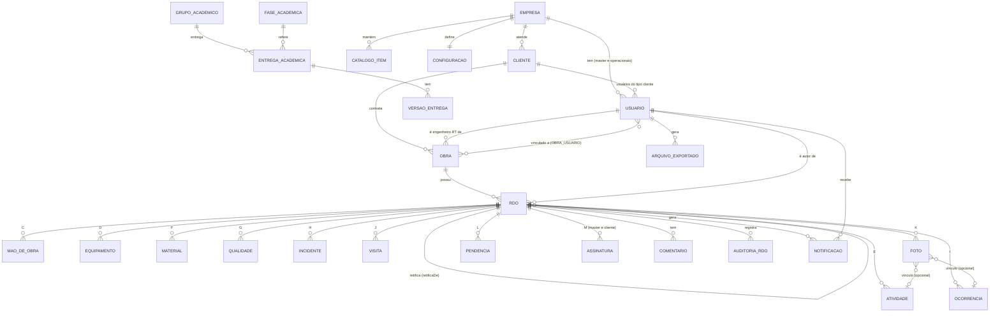

# Modelo de dados — RDO Mobile

Este documento descreve os dados que o back-end precisa guardar e entregar ao app. Foi montado a partir do código do repositório `mobile-app`:

- `src/data/seed.js`, `seedRdos.js` e `seedAcademico.js` (entidades e exemplos)
- `src/domain/rdo.js` (`criarRdoVazio`, formato do RDO)
- `src/store/actions.js` (o que cada ação grava)
- `src/constants/index.js` (valores permitidos de cada campo)

Exemplos reais de cada entidade estão em `docs/exemplos/*.json` (gerados por `node scripts/exportar-seed.js`).

> **Como ler:** a coluna **Tipo** é o tipo que o app usa hoje. Onde o servidor deve guardar de outro jeito, a coluna **Observação** diz. Itens marcados com ⚠️ são decisões abertas (lista completa no fim do documento).

## 1. Convenções

| Assunto                                            | Como está hoje no app                                                                                                                                                                                        | O que o servidor deve fazer                                                                                                          |
| -------------------------------------------------- | ------------------------------------------------------------------------------------------------------------------------------------------------------------------------------------------------------------ | ------------------------------------------------------------------------------------------------------------------------------------ |
| **Identificadores**                                | Texto com prefixo: `rdo_alfa_0005`, `u_joao`, `obra_alfa`. O app gera ids novos com `uid('rdo')` (prefixo + data + contador + aleatório).                                                                    | Gerar o id (UUID ou equivalente) e devolver ao app. ⚠️ Para o envio offline é preciso um id temporário no aparelho (ver decisão M3). |
| **Data** (`data`, `inicio`, `fim`)                 | Texto `AAAA-MM-DD`, sem fuso.                                                                                                                                                                                | Coluna `date`.                                                                                                                       |
| **Hora** (`horaInicio`, `chuvaInicio`, `entrada`…) | Texto `HH:MM`.                                                                                                                                                                                               | Guardar como texto `HH:MM` (ou `time`). Validar com a regra de 0:00 a 23:59.                                                         |
| **Data e hora** (`criadoEm`, `dataHora`…)          | Texto ISO 8601 em UTC: `2026-10-08T13:30:00.000Z`.                                                                                                                                                           | `timestamptz`. **A hora oficial é a do servidor** (o app só mostra).                                                                 |
| **Fuso da obra**                                   | Fixo em UTC−3 (`OBRA_OFFSET_MIN = -180` em `utils/date.js`). "Hoje" e "data futura" são calculados nesse fuso.                                                                                               | O servidor aplica o mesmo fuso para validar "data futura".                                                                           |
| **Números**                                        | Quase todos são **texto**, e muitos usam vírgula decimal: `quantidade: "2"`, `horas: "8"`, `quantidadeDia: "42,0"`, `precipitacaoMm: "4"`. O app converte com `toNumber` (aceita `8,5`, `8.5` e `1.234,56`). | ⚠️ Decisão M1: o contrato propõe número JSON com ponto decimal. O app converte na ida e na volta.                                    |
| **Valores de lista** (enum)                        | Chaves em minúsculas sem acento: `em_analise`, `chuva_fraca`. Os rótulos ficam no app (`constants/index.js`).                                                                                                | Guardar a chave; nunca o rótulo.                                                                                                     |
| **Senha**                                          | Campo `senha` em texto puro dentro de `users` (todos com `123456`).                                                                                                                                          | Só existe `senhaHash`. Nenhuma resposta da API devolve senha. Ver `docs/api.md`.                                                     |
| **Campos calculados**                              | Total de trabalhadores, homem-hora, horas de equipamento, acumulado anterior, progresso do formulário. Não são gravados.                                                                                     | Não gravar; calcular ao ler quando precisar (regras em `domain/rdo.js`).                                                             |

## 2. Diagrama entidade-relacionamento

Pontos de atenção:

- **Chave natural do RDO:** `(obraId, numero, versao)` é única. Uma retificação cria uma **nova linha** com o mesmo `numero` e `versao + 1`; a antiga vira `retificado` e nunca é apagada.
- **Unicidade de data e turno:** `(obraId, data, turno)` entre RDOs ativos (nem `cancelado` nem `retificado`). Hoje o app trata como **aviso**, não bloqueio (ver M5).
- **Vínculo usuário–obra:** no app é a lista `obra.usuarioIds`. No banco vira tabela `obra_usuario(obraId, usuarioId)`. O master enxerga todas as obras sem precisar de vínculo.

## 3. Entidades

### 3.1 Empresa

Uma única empresa no protótipo (`state.empresa`). Editada pelo master (`salvarEmpresa`).

| Campo         | Tipo  | Obrig. | Exemplo                                   | Observação                                                            |
| ------------- | ----- | ------ | ----------------------------------------- | --------------------------------------------------------------------- |
| `id`          | id    | sim    | `emp_planengen`                           |                                                                       |
| `nome`        | texto | sim    | `PLANENGEN Consultoria e Construção LTDA` | Copiado para `obra.empresaExecutora` quando a obra não informa outro. |
| `cnpj`        | texto | sim    | `00.000.000/0001-00`                      | Validar formato.                                                      |
| `cidade`      | texto | não    | `São Luís/MA`                             |                                                                       |
| `email`       | texto | não    | `contato@planengen.com.br`                |                                                                       |
| `telefone`    | texto | não    | `(98) 3200-0000`                          |                                                                       |
| `responsavel` | texto | não    | `Eng. Carlos Lima`                        |                                                                       |

### 3.2 Cliente

Empresa contratante da obra (`state.clientes`). Não é o mesmo que o **usuário** do perfil cliente (ver 3.3).

| Campo      | Tipo  | Obrig. | Exemplo                           | Observação                                                                  |
| ---------- | ----- | ------ | --------------------------------- | --------------------------------------------------------------------------- |
| `id`       | id    | sim    | `cli_horizonte`                   |                                                                             |
| `nome`     | texto | sim    | `Grupo Horizonte Empreendimentos` | Ao alterar, o app atualiza `obra.clienteNome` de todas as obras do cliente. |
| `contato`  | texto | não    | `Fernanda Albuquerque`            |                                                                             |
| `email`    | texto | não    | `cliente@horizonte.com.br`        |                                                                             |
| `telefone` | texto | não    | `(98) 98800-1001`                 |                                                                             |

### 3.3 Usuário

Pessoa que entra no app (`state.users`). Três perfis: `master`, `operacional`, `cliente`.

| Campo       | Tipo         | Obrig.                 | Exemplo / valores                              | Observação                                                                                                                                        |
| ----------- | ------------ | ---------------------- | ---------------------------------------------- | ------------------------------------------------------------------------------------------------------------------------------------------------- |
| `id`        | id           | sim                    | `u_joao`                                       |                                                                                                                                                   |
| `nome`      | texto        | sim                    | `João Ribeiro`                                 |                                                                                                                                                   |
| `email`     | texto        | sim                    | `operacional@planengen.com.br`                 | Único. É o login.                                                                                                                                 |
| `senha`     | texto        | —                      | `123456`                                       | **Só no mock.** No servidor: `senhaHash`. A senha inicial deixa de ser fixa; o convite por e-mail hoje é simulado (`salvarUsuario`).              |
| `perfil`    | enum         | sim                    | `master`, `operacional`, `cliente`             |                                                                                                                                                   |
| `cargo`     | texto        | não                    | `Mestre de obras`                              |                                                                                                                                                   |
| `telefone`  | texto        | não                    | `(98) 98800-0002`                              |                                                                                                                                                   |
| `clienteId` | id → Cliente | só no perfil `cliente` | `cli_horizonte`                                | Liga o usuário à empresa contratante.                                                                                                             |
| `ativo`     | boolean      | sim                    | `true`                                         | `false` = bloqueado. Bloqueado não entra e não recebe notificação (`alternarUsuarioAtivo`).                                                       |
| `canais`    | objeto       | sim                    | `{ push: true, email: true, whatsapp: false }` | Preferência de notificação do usuário (`atualizarCanais`).                                                                                        |
| `crea`      | texto        | não                    | `CREA 123456789-0 MA`                          | O código lê `usuario.crea` ao montar `obra.engenheiroRT`, mas o seed não preenche. Hoje, sem CREA, o app escreve um valor fixo de exemplo. ⚠️ M8. |
| `criadoEm`  | data e hora  | sim                    | `2026-09-03T15:00:00.000Z`                     | Definido pelo servidor.                                                                                                                           |

**Dados que hoje vivem só na sessão do aparelho** (`state.session`) e que o servidor deve assumir:

| Dado no app                              | O que é                                                        | Proposta no servidor                                                        |
| ---------------------------------------- | -------------------------------------------------------------- | --------------------------------------------------------------------------- |
| `termosAceitos[userId] = { em, opcoes }` | Aceite dos termos de uso e das opções de consentimento (LGPD). | Tabela `aceite_termos(usuarioId, aceitoEm, opcoes, versaoTermos)`.          |
| `biometria[userId]`                      | Se o usuário ativou biometria **neste aparelho**.              | Continua no aparelho (a biometria é local); o servidor não precisa saber.   |
| `deviceId`                               | Identificador de instalação gerado no primeiro uso.            | Pode ir como cabeçalho `X-Device-Id` para compor a evidência da assinatura. |
| `manter`, `ultimoUserId`                 | "Manter conectado" e último usuário.                           | Só no aparelho.                                                             |

### 3.4 Obra

(`state.obras`; editada por `salvarObra`.)

| Campo                        | Tipo             | Obrig.   | Exemplo / valores                               | Observação                                                      |
| ---------------------------- | ---------------- | -------- | ----------------------------------------------- | --------------------------------------------------------------- |
| `id`                         | id               | sim      | `obra_alfa`                                     |                                                                 |
| `nome`                       | texto            | sim      | `Obra Alfa`                                     |                                                                 |
| `descricao`                  | texto            | não      | `Residencial Alfa — Bloco A`                    |                                                                 |
| `contrato`                   | texto            | sim      | `CT-014`                                        |                                                                 |
| `os`                         | texto            | não      | `OS 021/2026`                                   |                                                                 |
| `clienteId`                  | id → Cliente     | sim      | `cli_horizonte`                                 |                                                                 |
| `clienteNome`                | texto            | derivado | `Grupo Horizonte Empreendimentos`               | Cópia do nome do cliente. Servidor pode devolver calculado.     |
| `empresaExecutora`           | texto            | derivado | `PLANENGEN…`                                    | Se vazio, usa o nome da empresa.                                |
| `endereco`                   | texto            | sim      | `Av. dos Holandeses, s/n — Calhau, São Luís/MA` |                                                                 |
| `inicio`                     | data             | sim      | `2026-07-30`                                    | Início do contrato.                                             |
| `inicioRegistro`             | data             | sim      | `2026-10-02`                                    | Primeiro dia do RDO digital. É diferente do início do contrato. |
| `fim`                        | data             | sim      | `2027-07-30`                                    | Fim do contrato.                                                |
| `engenheiroRTId`             | id → Usuário     | sim      | `u_master`                                      |                                                                 |
| `engenheiroRT`               | texto            | derivado | `Eng. Carlos Lima — CREA 123456789-0 MA`        | Texto que vai para o RDO e o PDF.                               |
| `diasUteis`                  | lista de números | sim      | `[1,2,3,4,5,6]`                                 | Dias da semana trabalhados (0 = domingo … 6 = sábado).          |
| `exigeAssinaturaOperacional` | boolean          | sim      | `true`                                          | Se `true`, a submissão exige `assinaturaOperacional` (regra M). |
| `status`                     | enum             | sim      | `ativa`, `paralisada`, `concluida`              | Valores em `ObrasListScreen.STATUS_OBRA`.                       |
| `avancoFisico`               | número (%)       | não      | `38`                                            | Hoje fixo no seed. ⚠️ M9: dizer de onde vem.                    |
| `avancoPrevisto`             | número (%)       | não      | `41`                                            | Idem.                                                           |
| `usuarioIds`                 | lista de ids     | sim      | `["u_joao","u_fernanda"]`                       | Vira a tabela `obra_usuario`.                                   |

### 3.5 RDO (cabeçalho)

É a entidade central (`state.rdos`). Os blocos A–M da seção 7 do documento-base ficam em tabelas filhas (itens 3.6 a 3.16). Um RDO inteiro, com todos os filhos, trafega como um único objeto JSON.

| Campo                      | Tipo           | Obrig.                    | Exemplo / valores                                                                                                          | Observação                                                                                                                                     |
| -------------------------- | -------------- | ------------------------- | -------------------------------------------------------------------------------------------------------------------------- | ---------------------------------------------------------------------------------------------------------------------------------------------- |
| `id`                       | id             | sim                       | `rdo_alfa_0005`                                                                                                            |                                                                                                                                                |
| `obraId`                   | id → Obra      | sim                       | `obra_alfa`                                                                                                                |                                                                                                                                                |
| `numero`                   | inteiro        | sim                       | `5`                                                                                                                        | Sequencial por obra (RF-04). **Quem gera é o servidor.** Mostrado com 4 dígitos (`0005`). Nunca é reaproveitado, mesmo se o RDO for cancelado. |
| `versao`                   | inteiro        | sim                       | `1`                                                                                                                        | Sobe a cada retificação. O número se mantém.                                                                                                   |
| `data`                     | data           | sim                       | `2026-10-07`                                                                                                               | Não pode ser futura (fuso da obra).                                                                                                            |
| `turno`                    | enum           | sim                       | `diurno`, `noturno`, `misto`                                                                                               |                                                                                                                                                |
| `status`                   | enum           | sim                       | `rascunho`, `submetido`, `em_analise`, `devolvido`, `validado`, `enviado_cliente`, `finalizado`, `retificado`, `cancelado` | Transições em `docs/regras-de-negocio.md`.                                                                                                     |
| `autorId`                  | id → Usuário   | sim                       | `u_joao`                                                                                                                   | Só o autor edita enquanto `rascunho` ou `devolvido`.                                                                                           |
| `criadoEm`, `atualizadoEm` | data e hora    | sim                       |                                                                                                                            | Servidor.                                                                                                                                      |
| `retificaDe`               | id → RDO       | não                       | `rdo_beta_0003`                                                                                                            | Preenchido na nova versão.                                                                                                                     |
| `retificadoPor`            | id → RDO       | não                       | `rdo_beta_0003_v2`                                                                                                         | Preenchido na versão antiga.                                                                                                                   |
| `motivoRetificacao`        | texto          | só na versão retificadora |                                                                                                                            | Obrigatório ao retificar.                                                                                                                      |
| `reaproveitadoDe`          | id → RDO       | não                       |                                                                                                                            | Campo opcional que o app grava quando o RDO nasce "copiado do dia anterior" (RNF-04). Só informativo.                                          |
| `identificacao`            | objeto         | sim                       | ver abaixo                                                                                                                 | **Cópia (snapshot)** dos dados da obra no momento da criação. Deve continuar igual depois de assinado, mesmo que a obra mude.                  |
| `observacaoMaoDeObra`      | texto          | não                       |                                                                                                                            | Observação do bloco C.                                                                                                                         |
| `semProducao`              | objeto         | sim                       | `{ ativo: false, justificativa: "" }`                                                                                      | "Dia sem produção". Se `ativo`, a justificativa é obrigatória e dispensa atividades.                                                           |
| `planejamento`             | objeto         | sim                       | `{ proximoDia, restricoes }`                                                                                               | Bloco L.                                                                                                                                       |
| `semRegistro`              | objeto         | sim                       | `{ materiais, qualidade, ocorrencias, visitas, pendencias }` (booleans)                                                    | Marca "nada a registrar" em cada bloco, para diferenciar vazio de esquecido.                                                                   |
| `observacoesGerais`        | texto          | não                       |                                                                                                                            |                                                                                                                                                |
| `declaracao`               | objeto         | sim                       | `{ aceita: true, dataHora }`                                                                                               | Declaração de responsabilidade. `dataHora` é preenchida na submissão.                                                                          |
| `assinaturaOperacional`    | objeto ou nulo | só se a obra exigir       | ver 3.14                                                                                                                   |                                                                                                                                                |
| `submetidoEm`              | data e hora    | não                       |                                                                                                                            | Base do prazo de 24 h do master.                                                                                                               |
| `devolucao`                | objeto ou nulo | só se `devolvido`         | `{ motivo, prazo, por, em }`                                                                                               | `prazo` é data e hora limite para o operacional corrigir.                                                                                      |
| `sync`                     | objeto         | sim                       | `{ pendente: false, ultimoEm }`                                                                                            | Controle do envio offline. No servidor o RDO só existe depois de sincronizado; ver M3.                                                         |
| `esclarecimentoPendente`   | boolean        | sim                       | `false`                                                                                                                    | `true` quando o cliente pediu esclarecimento e o master ainda não respondeu.                                                                   |
| `assinaturas`              | objeto         | sim                       | `{ master, cliente }`                                                                                                      | Ver 3.14.                                                                                                                                      |
| `hashTecnico`              | texto (64)     | após validar              |                                                                                                                            | SHA-256 do conteúdo técnico, gerado pelo servidor na assinatura do master.                                                                     |
| `hashFinal`                | texto (64)     | após finalizar            |                                                                                                                            | SHA-256 do conjunto técnico + master + cliente.                                                                                                |
| `liberadoAoClienteEm`      | data e hora    | não                       |                                                                                                                            | Base dos prazos de 24/48/72 h do cliente. Também decide se o cliente ainda vê um RDO retificado ou cancelado.                                  |
| `finalizadoEm`             | data e hora    | não                       |                                                                                                                            |                                                                                                                                                |
| `cancelamento`             | objeto ou nulo | só se `cancelado`         | `{ motivo, por, em }`                                                                                                      |                                                                                                                                                |

`identificacao` (cópia dos dados da obra):

| Campo                      | Exemplo                                         |
| -------------------------- | ----------------------------------------------- |
| `contrato`                 | `CT-014`                                        |
| `os`                       | `OS 021/2026`                                   |
| `cliente`                  | `Grupo Horizonte Empreendimentos`               |
| `empresa`                  | `PLANENGEN Consultoria e Construção LTDA`       |
| `endereco`                 | `Av. dos Holandeses, s/n — Calhau, São Luís/MA` |
| `engenheiroRT`             | `Eng. Carlos Lima — CREA 123456789-0 MA`        |
| `periodoContratual`        | `30/07/2026 a 30/07/2027` (texto já formatado)  |
| `responsavelPreenchimento` | `João Ribeiro`                                  |

### 3.6 Bloco B — Clima (objeto `rdo.clima`)

| Campo                                | Tipo                               | Obrig.                               | Valores                                                                                                                    | Observação                             |
| ------------------------------------ | ---------------------------------- | ------------------------------------ | -------------------------------------------------------------------------------------------------------------------------- | -------------------------------------- |
| `periodos.manha`, `.tarde`, `.noite` | objeto `{ condicao, temperatura }` | ao menos 1 período com `condicao`    | `condicao`: `ensolarado`, `parc_nublado`, `nublado`, `chuva_fraca`, `chuva_moderada`, `chuva_forte`, `ventania`, `neblina` | `temperatura` em °C, opcional, número. |
| `choveu`                             | boolean                            | sim                                  |                                                                                                                            | Se `true`, exige duração e/ou mm.      |
| `chuvaInicio`, `chuvaFim`            | hora                               | se `choveu` (e não informar mm)      | `HH:MM`                                                                                                                    | Fim deve ser posterior ao início.      |
| `precipitacaoMm`                     | número                             | se `choveu` (e não informar duração) | `4`                                                                                                                        |                                        |
| `impacto`                            | enum                               | se `choveu`                          | `nenhum`, `parcial`, `total`                                                                                               |                                        |
| `horasParalisadas`                   | hora (duração)                     | se `impacto` ≠ `nenhum`              | `00:35`                                                                                                                    | Formato `HH:MM`.                       |
| `fonte`                              | enum                               | sim                                  | `manual`, `pluviometro` (`integracao` ainda desabilitado)                                                                  |                                        |
| `observacao`                         | texto                              | não                                  |                                                                                                                            |                                        |

### 3.7 Bloco C — Mão de obra (`rdo.maoDeObra[]`)

| Campo                   | Tipo                | Obrig. | Exemplo          | Observação                                                                                      |
| ----------------------- | ------------------- | ------ | ---------------- | ----------------------------------------------------------------------------------------------- |
| `id`                    | id                  | sim    |                  |                                                                                                 |
| `empresa`               | texto               | não    | `Equipe própria` | Lista em `catalogos.origensEmpresa`.                                                            |
| `funcao`                | texto               | sim    | `Pedreiro`       | Lista em `catalogos.funcoes`.                                                                   |
| `quantidade`            | inteiro ≥ 1         | sim    | `4`              |                                                                                                 |
| `horaInicio`, `horaFim` | hora                | não    | `07:00`, `16:00` |                                                                                                 |
| `horas`                 | número (0 < h ≤ 24) | sim    | `8`              | O app calcula a partir de início e fim, descontando 1 h de intervalo se a jornada passa de 6 h. |
| `observacao`            | texto               | não    |                  |                                                                                                 |

Total de trabalhadores = soma de `quantidade`. Homem-hora = soma de `quantidade × horas`.

### 3.8 Bloco D — Equipamentos (`rdo.equipamentos[]`)

| Campo              | Tipo        | Obrig.    | Valores / exemplo                                        | Observação                                           |
| ------------------ | ----------- | --------- | -------------------------------------------------------- | ---------------------------------------------------- |
| `id`               | id          | sim       |                                                          |                                                      |
| `tipo`             | texto       | sim       | `Betoneira`                                              | `catalogos.equipamentos`.                            |
| `identificacao`    | texto       | não       | `BET-01`                                                 | Placa ou código.                                     |
| `quantidade`       | inteiro ≥ 1 | sim       | `1`                                                      |                                                      |
| `horasDisponiveis` | número      | sim       | `8`                                                      |                                                      |
| `horasProdutivas`  | número      | sim       | `7`                                                      | Produtivas + paradas não pode passar de disponíveis. |
| `horasParadas`     | número      | sim       | `1`                                                      | Obrigatória e > 0 se parado.                         |
| `motivoParada`     | texto       | se parado | `Chuva e limpeza`                                        |                                                      |
| `operador`         | texto       | não       |                                                          |                                                      |
| `condicao`         | enum        | sim       | `operante`, `operante_restricao`, `manutencao`, `parado` |                                                      |
| `observacao`       | texto       | não       |                                                          |                                                      |

### 3.9 Bloco E — Atividades (`rdo.atividades[]`)

| Campo           | Tipo         | Obrig. | Valores / exemplo                                         | Observação                   |
| --------------- | ------------ | ------ | --------------------------------------------------------- | ---------------------------- |
| `id`            | id           | sim    |                                                           |                              |
| `frente`        | texto        | não    | `Pavimento térreo, eixos B–D`                             | `catalogos.frentes`.         |
| `servico`       | texto        | sim    | `Alvenaria de vedação`                                    | `catalogos.servicos`.        |
| `descricao`     | texto        | não    |                                                           |                              |
| `unidade`       | texto        | sim    | `m²`                                                      | `catalogos.unidades`.        |
| `quantidadeDia` | número       | sim    | `42,0`                                                    | Quantidade executada no dia. |
| `referenciaEAP` | texto        | não    | `2.3`                                                     |                              |
| `percentual`    | número 0–100 | não    | `38`                                                      |                              |
| `situacao`      | enum         | sim    | `nao_iniciada`, `em_andamento`, `concluida`, `paralisada` |                              |
| `observacao`    | texto        | não    |                                                           |                              |

O **acumulado anterior** do serviço é calculado (`acumuladoAnterior`): soma de `quantidadeDia` dos RDOs da mesma obra, anteriores à data, que não são `rascunho`, `cancelado` nem `retificado`, com o mesmo `servico` (ignorando maiúsculas e espaços).

### 3.10 Blocos F e G — Materiais e Qualidade

`rdo.materiais[]`:

| Campo            | Tipo   | Obrig.                            | Valores / exemplo                                   |
| ---------------- | ------ | --------------------------------- | --------------------------------------------------- |
| `id`             | id     | sim                               |                                                     |
| `movimento`      | enum   | sim                               | `recebido`, `utilizado`                             |
| `material`       | texto  | sim                               | `Cimento CP-II (saco 50 kg)`                        |
| `unidade`        | texto  | sim                               | `saco`                                              |
| `quantidade`     | número | sim                               | `32`                                                |
| `fornecedor`     | texto  | não                               |                                                     |
| `notaRomaneio`   | texto  | recomendado se `recebido` (aviso) | `NF 4065`                                           |
| `lote`           | texto  | não                               |                                                     |
| `localAplicacao` | texto  | não                               |                                                     |
| `inspecao`       | enum   | não                               | `aceito`, `aceito_ressalva`, `recusado`, `pendente` |
| `armazenamento`  | texto  | não                               |                                                     |

`rdo.qualidade[]`:

| Campo         | Tipo  | Obrig.                                    | Valores / exemplo                                     |
| ------------- | ----- | ----------------------------------------- | ----------------------------------------------------- |
| `id`          | id    | sim                                       |                                                       |
| `tipo`        | enum  | sim                                       | `inspecao`, `ensaio`, `nao_conformidade`, `liberacao` |
| `descricao`   | texto | sim                                       |                                                       |
| `resultado`   | enum  | não                                       | `conforme`, `nao_conforme`, `pendente`                |
| `documento`   | texto | não                                       |                                                       |
| `responsavel` | texto | recomendado se `nao_conformidade` (aviso) |                                                       |
| `observacao`  | texto | não                                       |                                                       |

### 3.11 Bloco H — Segurança e meio ambiente (`rdo.seguranca`)

| Campo            | Tipo                                                        | Observação                                                                                                                                                                    |
| ---------------- | ----------------------------------------------------------- | ----------------------------------------------------------------------------------------------------------------------------------------------------------------------------- |
| `dds`            | `{ realizado: boolean, tema: texto, participantes: texto }` | `participantes` é guardado como texto com o número (ex.: `"12"`).                                                                                                             |
| `epiEpc`         | `{ conferidos: boolean, observacao: texto }`                |                                                                                                                                                                               |
| `permissoes`     | texto                                                       | Permissões de trabalho.                                                                                                                                                       |
| `inspecoes`      | texto                                                       |                                                                                                                                                                               |
| `semIncidentes`  | boolean                                                     | Se `false` e a lista vazia, o app só avisa (não bloqueia).                                                                                                                    |
| `incidentes[]`   | lista                                                       | Cada item: `id`, `tipo` (`quase_acidente`, `acidente_sem_afastamento`, `acidente_com_afastamento`, `incidente_ambiental`, `outro`), `descricao` (obrigatória), `providencia`. |
| `residuos`       | texto                                                       |                                                                                                                                                                               |
| `condicionantes` | texto                                                       |                                                                                                                                                                               |
| `providencias`   | texto                                                       |                                                                                                                                                                               |

### 3.12 Blocos I e J — Ocorrências e Visitas

`rdo.ocorrencias[]`:

| Campo                                              | Tipo    | Obrig.                 | Exemplo                                         |
| -------------------------------------------------- | ------- | ---------------------- | ----------------------------------------------- |
| `id`                                               | id      | sim                    |                                                 |
| `codigo`                                           | texto   | sim (gerado: `OC-001`) | `OC-001` (sequência dentro do RDO)              |
| `fato`                                             | texto   | sim                    | `Chuva moderada — serviços externos suspensos.` |
| `horario`                                          | hora    | sim                    | `14:10`                                         |
| `local`                                            | texto   | recomendado (aviso)    |                                                 |
| `partes`                                           | texto   | não                    | `Encarregado`                                   |
| `impactoPrazo`, `impactoCusto`, `impactoQualidade` | boolean | sim                    |                                                 |
| `acaoImediata`                                     | texto   | não                    |                                                 |
| `responsavel`                                      | texto   | recomendado (aviso)    |                                                 |
| `prazo`                                            | data    | não                    |                                                 |
| `observacao`                                       | texto   | não                    |                                                 |

`rdo.visitas[]`:

| Campo              | Tipo  | Obrig. | Exemplo                                 |
| ------------------ | ----- | ------ | --------------------------------------- |
| `id`               | id    | sim    |                                         |
| `visitante`        | texto | sim    | `Fernanda Albuquerque`                  |
| `empresaCargo`     | texto | não    | `Grupo Horizonte — Gerente de Projetos` |
| `entrada`, `saida` | hora  | não    | `09:30`, `10:15`                        |
| `motivo`           | texto | sim    |                                         |
| `orientacao`       | texto | não    |                                         |
| `atendidoPor`      | texto | não    |                                         |

### 3.13 Bloco K — Fotos (`rdo.fotos[]`) e Bloco L — Pendências (`rdo.pendencias[]`)

`rdo.fotos[]`:

| Campo          | Tipo                                        | Obrig.              | Observação                                                                                                                        |
| -------------- | ------------------------------------------- | ------------------- | --------------------------------------------------------------------------------------------------------------------------------- |
| `id`           | id                                          | sim                 |                                                                                                                                   |
| `numero`       | inteiro                                     | sim                 | Ordem no RDO (`Foto 01`).                                                                                                         |
| `uri`          | texto ou nulo                               | sim                 | No app é o caminho local do arquivo. No servidor vira `url` (ou chave do armazenamento). `null` no seed (foto de demonstração).   |
| `legenda`      | texto                                       | **sim**             | Sem legenda a submissão é bloqueada.                                                                                              |
| `local`        | texto                                       | recomendado (aviso) |                                                                                                                                   |
| `vinculo`      | `{ tipo: "atividade" \| "ocorrencia", id }` | não                 | Liga a foto à atividade ou ocorrência que ela comprova.                                                                           |
| `autorId`      | id → Usuário                                | sim                 |                                                                                                                                   |
| `dataHora`     | data e hora                                 | sim                 | Hora da captura.                                                                                                                  |
| `coordenada`   | `{ latitude, longitude }` ou nulo           | não                 | Opcional (permissão de localização).                                                                                              |
| `meta`         | `{ largura, altura, compressao }`           | sim                 | Ex.: `1600 × 1200`, compressão `80`.                                                                                              |
| `envio`        | enum                                        | sim                 | `enviada` ou `local` (ainda só no aparelho, aguardando envio). Só serve ao app; no servidor, a foto existir já significa enviada. |
| `cor`, `icone` | texto                                       | —                   | **Só no seed**, para desenhar um quadrado colorido quando não há imagem. Não vão para o servidor.                                 |

`rdo.pendencias[]`:

| Campo         | Tipo  | Obrig. | Valores / exemplo                                                                  |
| ------------- | ----- | ------ | ---------------------------------------------------------------------------------- |
| `id`          | id    | sim    |                                                                                    |
| `descricao`   | texto | sim    |                                                                                    |
| `origem`      | enum  | não    | `projeto`, `cliente`, `fornecedor`, `execucao`, `qualidade`, `seguranca`, `outros` |
| `responsavel` | texto | sim    |                                                                                    |
| `prazo`       | data  | sim    |                                                                                    |
| `prazoHora`   | hora  | não    | `12:00`                                                                            |
| `criticidade` | enum  | sim    | `baixa`, `media`, `alta`, `critica`                                                |
| `status`      | enum  | sim    | `aberta`, `andamento`, `resolvida`                                                 |

Ao "reaproveitar o dia anterior", as pendências **não resolvidas** são copiadas para o novo RDO.

### 3.14 Assinatura (bloco M)

Três lugares guardam assinatura. As duas oficiais ficam em `rdo.assinaturas`; a do operacional em `rdo.assinaturaOperacional`.

| Campo                         | Em qual          | Tipo                                       | Observação                                                                                               |
| ----------------------------- | ---------------- | ------------------------------------------ | -------------------------------------------------------------------------------------------------------- |
| `usuarioId`, `nome`           | todas            | id, texto                                  |                                                                                                          |
| `papel`                       | master e cliente | enum                                       | `master` ou `cliente`.                                                                                   |
| `dataHora`                    | todas            | data e hora                                | **Servidor** define.                                                                                     |
| `versao`                      | master e cliente | inteiro                                    | Versão do RDO assinada.                                                                                  |
| `tipo`                        | só cliente       | enum                                       | `ciencia`, `ressalva` (`esclarecimento` não assina: só abre pendência).                                  |
| `texto`                       | só cliente       | texto                                      | Obrigatório em `ressalva`.                                                                               |
| `ip`                          | master e cliente | texto                                      | No app é simulado. **O servidor registra o IP real.**                                                    |
| `dispositivo`                 | master e cliente | texto                                      | Ex.: `Android 15 • Expo Go • a1b2c3`                                                                     |
| `metodo2fa`                   | master e cliente | enum                                       | `otp` (código) ou `biometria`.                                                                           |
| `declaracao`                  | master e cliente | texto                                      | Texto jurídico no momento da assinatura (`constants/texts.js`). Guardar o texto exato, não só uma chave. |
| `hash`                        | master e cliente | texto (64)                                 | Cópia do `hashTecnico` do RDO.                                                                           |
| `tracos`, `largura`, `altura` | todas            | lista de listas de pontos `{x,y}`, números | Assinatura desenhada, em um quadro de 300 × 120.                                                         |

### 3.15 Comentário (`rdo.comentarios[]`)

| Campo          | Tipo         | Valores / observação                                                                                                                                                          |
| -------------- | ------------ | ----------------------------------------------------------------------------------------------------------------------------------------------------------------------------- |
| `id`           | id           |                                                                                                                                                                               |
| `autorId`      | id → Usuário |                                                                                                                                                                               |
| `papel`        | enum         | Perfil de quem comentou.                                                                                                                                                      |
| `tipo`         | enum         | `comentario`, `resposta` (do master a um esclarecimento), `devolucao`, `esclarecimento` (do cliente), `sistema` (nota automática, ex.: edição pelo master).                   |
| `contexto`     | enum         | `geral` ou a chave de um passo: `identificacao`, `clima`, `maoDeObra`, `equipamentos`, `atividades`, `materiaisQualidade`, `seguranca`, `ocorrencias`, `fotos`, `pendencias`. |
| `contextoRef`  | id ou nulo   | Item específico (ex.: id de uma foto).                                                                                                                                        |
| `texto`        | texto        |                                                                                                                                                                               |
| `dataHora`     | data e hora  |                                                                                                                                                                               |
| `visibilidade` | enum         | `interno` (master e operacional) ou `cliente` (o cliente também enxerga).                                                                                                     |

### 3.16 Auditoria

**Auditoria do RDO** (`rdo.auditoria[]`): imutável, só inclui.

| Campo       | Tipo              | Observação                                                                                                                                                                                                                                                                                                                                                                                                    |
| ----------- | ----------------- | ------------------------------------------------------------------------------------------------------------------------------------------------------------------------------------------------------------------------------------------------------------------------------------------------------------------------------------------------------------------------------------------------------------- |
| `id`        | id                |                                                                                                                                                                                                                                                                                                                                                                                                               |
| `dataHora`  | data e hora       |                                                                                                                                                                                                                                                                                                                                                                                                               |
| `evento`    | enum              | `criacao`, `rascunho_salvo`, `submissao`, `sincronizacao`, `visualizacao`, `analise_iniciada`, `comentario`, `devolucao`, `correcao_reenvio`, `edicao_master`, `validacao`, `envio_cliente`, `ciencia_cliente`, `ressalva_cliente`, `esclarecimento_cliente`, `esclarecimento_respondido`, `finalizacao`, `pdf_gerado`, `retificacao`, `cancelamento`, `exclusao`, `exportacao`, `usuario`, `obra`, `sessao`. |
| `usuarioId` | id ou `"sistema"` | `sistema` é usado em `finalizacao`.                                                                                                                                                                                                                                                                                                                                                                           |
| `versao`    | inteiro           | Versão do RDO no momento do evento.                                                                                                                                                                                                                                                                                                                                                                           |
| `detalhe`   | texto             |                                                                                                                                                                                                                                                                                                                                                                                                               |
| `meta`      | objeto, opcional  | Em `edicao_master`: `{ justificativa, alteracoes[] }` (antes e depois dos campos mudados).                                                                                                                                                                                                                                                                                                                    |

Eventos que o **cliente** pode ver: `validacao`, `envio_cliente`, `ciencia_cliente`, `ressalva_cliente`, `esclarecimento_cliente`, `esclarecimento_respondido`, `finalizacao`, `retificacao` (`EVENTOS_PUBLICOS`).

**Auditoria global** (`state.auditoriaGlobal`): eventos que não pertencem a um RDO (`obra`, `usuario`, `exclusao`, `exportacao`).

| Campo                                              | Tipo       |
| -------------------------------------------------- | ---------- |
| `id`, `dataHora`, `evento`, `usuarioId`, `detalhe` | como acima |

⚠️ No app, a auditoria de um RDO vive **dentro** do objeto RDO. No banco deve ser tabela separada, só de inclusão.

### 3.17 Notificação (`state.notifications`)

| Campo                          | Tipo                | Observação                                                                                                                                                |
| ------------------------------ | ------------------- | --------------------------------------------------------------------------------------------------------------------------------------------------------- |
| `id`                           | id                  |                                                                                                                                                           |
| `usuarioId`                    | id → Usuário        | Destinatário.                                                                                                                                             |
| `tipo`                         | enum                | `rdo_submetido`, `rdo_devolvido`, `rdo_validado`, `cliente_manifestou`, `esclarecimento`, `prazo_vencido`, `lembrete`, `falha_entrega`, `sistema`.        |
| `titulo`, `mensagem`           | texto               |                                                                                                                                                           |
| `obraId`, `rdoId`, `rdoStatus` | id, id, enum        | Atalho para abrir o registro. `rdoStatus` é o status no momento do envio.                                                                                 |
| `prazo`                        | data e hora ou nulo |                                                                                                                                                           |
| `dataHora`                     | data e hora         |                                                                                                                                                           |
| `lida`                         | boolean             |                                                                                                                                                           |
| `resolvida`                    | boolean, opcional   | Só aparece em `falha_entrega` depois que o master reenvia.                                                                                                |
| `chave`                        | texto ou nulo       | Evita lembrete duplicado. Formatos: `lem:master:<rdoId>:<horas>`, `lem:cliente:<rdoId>:<horas>`, `esc:master:<rdoId>`, `lem:prazo:<rdoId>`.               |
| `alvoId`                       | id ou nulo          | Em `falha_entrega`: usuário cuja entrega falhou.                                                                                                          |
| `entregas[]`                   | lista               | Uma por canal: `{ canal, status, em }`. `canal`: `push`, `email`, `whatsapp`. `status`: `entregue`, `falha`, `pendente`, `desativado`, `nao_configurado`. |

### 3.18 Arquivo exportado (`state.files`)

| Campo       | Tipo         | Exemplo                                     |
| ----------- | ------------ | ------------------------------------------- |
| `id`        | id           |                                             |
| `criadoEm`  | data e hora  |                                             |
| `criadoPor` | id → Usuário |                                             |
| `nome`      | texto        | `rdo_rdos_todos.csv`                        |
| `tipo`      | texto        | `csv`                                       |
| `descricao` | texto        | `12 RDOs · todas as obras · Todo o período` |

Hoje só é o **registro** de que a exportação aconteceu; o CSV é gerado no aparelho.

### 3.19 Catálogos (`state.catalogos`)

Listas de texto editáveis pelo master (`salvarCatalogo`). Sugestão: tabela `catalogo_item(empresaId, catalogo, valor, ordem)`.

| Chave            | Conteúdo                                                                         |
| ---------------- | -------------------------------------------------------------------------------- |
| `funcoes`        | Funções de mão de obra (18 no padrão).                                           |
| `equipamentos`   | Tipos de equipamento.                                                            |
| `servicos`       | Serviços (atividades).                                                           |
| `materiais`      | Materiais.                                                                       |
| `unidades`       | `m`, `m²`, `m³`, `kg`, `t`, `un`, `cj`, `vb`, `h`, `dia`, `l`, `saco`, `viagem`. |
| `frentes`        | Frentes de serviço.                                                              |
| `origensEmpresa` | `Equipe própria`, `Empreiteira terceirizada`, `Subcontratada`.                   |

### 3.20 Configurações (`state.settings`)

| Campo                          | Tipo             | Valor padrão | Observação                                                                            |
| ------------------------------ | ---------------- | ------------ | ------------------------------------------------------------------------------------- |
| `lembretes.operacionalFimDia`  | hora             | `18:00`      | Lembrete ao operacional no fim do dia.                                                |
| `lembretes.masterHoras`        | número           | `24`         | Prazo de análise do master (repete a cada múltiplo).                                  |
| `lembretes.clienteHoras`       | lista de números | `[24, 48]`   | Lembretes ao cliente.                                                                 |
| `lembretes.escalonamentoHoras` | número           | `72`         | Avisa o master se o cliente não responde.                                             |
| `inatividadeMin`               | número           | `0`          | Saída automática por inatividade (0 = desligada). Por aparelho ou por empresa? ⚠️ M7. |
| `forceOffline`                 | boolean          | `false`      | **Só do aparelho / demonstração.** Não vai para o servidor.                           |
| `simularFalhaEmail`            | boolean          | `false`      | **Só demonstração.** Não vai para o servidor.                                         |

### 3.21 Acadêmico (`state.academico`, RF-20)

Módulo opcional de acompanhamento das entregas dos grupos. Só o master acessa.

| Entidade                                    | Campos                                                                                                                                                                                             |
| ------------------------------------------- | -------------------------------------------------------------------------------------------------------------------------------------------------------------------------------------------------- |
| **Critério** (`criterios[]`)                | `id` (`c1`…`c6`), `nome`, `peso` (soma 100). Padrão em `CRITERIOS_PADRAO` (seedAcademico.js).                                                                                                      |
| **Fase** (`fases[]`)                        | `id` (1 a 10), `titulo`, `conteudo`. Padrão em `FASES_ACADEMICAS`.                                                                                                                                 |
| **Grupo** (`grupos[]`)                      | `id` (`g1`…), `nome`, `integrantes` (lista de nomes em texto, **não** são usuários).                                                                                                               |
| **Entrega** (`grupo.entregas[]`)            | `faseId`, `status` (`pendente`, `em_avaliacao`, `avaliada`), `notas` (objeto `{ criterioId: nota 0–10 }`), `notaFinal` (média ponderada, calculada por `notaFinal()`), `comentario`, `avaliadoEm`. |
| **Versão da entrega** (`entrega.versoes[]`) | `numero`, `data`, `arquivo` (nome do arquivo), `comentario`.                                                                                                                                       |

## 4. Decisões abertas

| #   | Decisão                                                        | Por que importa                                             | Sugestão                                                                                                                           |
| --- | -------------------------------------------------------------- | ----------------------------------------------------------- | ---------------------------------------------------------------------------------------------------------------------------------- |
| M1  | Números como texto com vírgula ou como número?                 | O app guarda `"42,0"`; o servidor precisa comparar e somar. | Contrato com número JSON (ponto decimal). A conversão fica no cliente HTTP (Pessoa 2).                                             |
| M2  | `identificacao` do RDO continua cópia?                         | Preserva o documento assinado.                              | Sim, manter cópia.                                                                                                                 |
| M3  | Como o app cria um RDO offline (sem `numero` oficial)?         | RF-04 diz que o número vem do servidor.                     | O app cria com um `idLocal` (UUID) e `numero = null`; o servidor devolve `id` e `numero` na sincronização. Alinhar com a Pessoa 2. |
| M4  | Armazenamento das fotos                                        | `uri` hoje é caminho no aparelho.                           | Envio em `multipart` para um endpoint próprio; o RDO guarda só a URL.                                                              |
| M5  | RDO duplicado (mesma obra, data e turno) bloqueia ou avisa?    | Hoje é só aviso.                                            | Manter aviso, mas o servidor devolve `409` com `confirmarDuplicado` se o app não confirmar. A definir com o solicitante.           |
| M6  | Auditoria dentro do RDO ou tabela separada                     | Imutabilidade e volume.                                     | Tabela separada, só de inclusão.                                                                                                   |
| M7  | `inatividadeMin` e `lembretes` são por empresa ou por usuário? | Hoje são globais.                                           | `lembretes` por empresa; `inatividadeMin` por empresa.                                                                             |
| M8  | `crea` do usuário                                              | O texto do RT sai com um CREA fixo de exemplo quando falta. | Campo obrigatório para o perfil master.                                                                                            |
| M9  | `avancoFisico` / `avancoPrevisto` da obra                      | Hoje são números fixos do seed.                             | Definir se serão digitados pelo master ou calculados.                                                                              |
