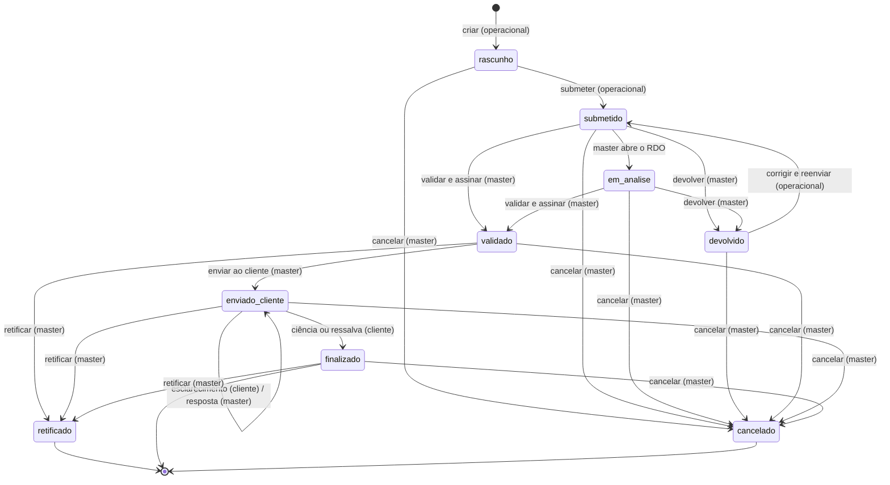

# Regras de negócio que o servidor precisa repetir

Hoje todas as regras rodam **no aparelho**, em funções puras. O servidor passa a ser a fonte da verdade e precisa aplicar as mesmas regras, porque o app pode ser adulterado e dois aparelhos podem agir ao mesmo tempo no mesmo RDO.

Fontes: `src/domain/workflow.js`, `src/domain/validation.js`, `src/domain/rdo.js`, `src/domain/lembretes.js`, `src/store/actions.js`, `src/constants/index.js`.

> **Achado importante:** as ações em `store/actions.js` **não verificam o perfil de quem chama**. Quem barra "o cliente não pode devolver um RDO" é a tela, escondendo o botão (`acoesDisponiveis` em `workflow.js`). Quando uma ação recebe um pedido inválido, ela simplesmente devolve o estado sem mudança (`return s`), sem erro. O servidor não pode fazer isso: precisa conferir perfil, vínculo com a obra e status em **toda** rota, e responder com erro claro (ver `docs/api.md`).

## 1. Estados do RDO e transições



Observações:

- Na ação **validar e assinar**, o app normalmente faz `validado` e `enviado_cliente` de uma vez (`enviarAgora = true`). Por isso `validado` pode durar zero tempo.
- **Retificar** não muda o RDO "para trás": o original vira `retificado` (para sempre) e nasce **outro RDO**, com o mesmo `numero`, `versao + 1`, em `rascunho`. Esse novo RDO percorre o fluxo inteiro de novo.
- **Excluir** não é um estado: remove o registro (ver 1.2).
- `retificado`, `cancelado` e `finalizado` são finais (`ehTerminal`).
- Um RDO bloqueado (`validado`, `enviado_cliente`, `finalizado`, `retificado`, `cancelado`) não pode ter o conteúdo editado (`estaBloqueado`).

### 1.1 Tabela de transições (o que cada ação faz)

Legenda de efeitos: **Aud.** = evento gravado na auditoria do RDO; **Notif.** = notificação criada (para quem e de que tipo).

| Ação (função no app)                                | De                                             | Para                                              | Quem pode                     | Condições e dados                                                                                                                       | Efeitos                                                                                                                                                                                                                                                                                   |
| --------------------------------------------------- | ---------------------------------------------- | ------------------------------------------------- | ----------------------------- | --------------------------------------------------------------------------------------------------------------------------------------- | ----------------------------------------------------------------------------------------------------------------------------------------------------------------------------------------------------------------------------------------------------------------------------------------- |
| Criar (`criarRdo`)                                  | —                                              | `rascunho`                                        | Operacional vinculado à obra  | `obraId`, `data`, `turno`. `numero` e `id` vêm do servidor.                                                                             | Aud. `criacao`.                                                                                                                                                                                                                                                                           |
| Salvar rascunho (`salvarRdo`)                       | `rascunho`, `devolvido`                        | igual                                             | O autor (operacional)         | Conteúdo do RDO. Qualquer outro status: ignora. O servidor deve responder erro `409`.                                                   | Aud. `rascunho_salvo` só se for salvamento manual. Campos de controle (`status`, `assinaturas`, hashes, `auditoria`…) nunca vêm do cliente.                                                                                                                                               |
| Submeter (`submeterRdo`)                            | `rascunho`                                     | `submetido`                                       | O autor                       | Passa em **todas** as validações de erro (seção 3).                                                                                     | Grava `submetidoEm`, `declaracao.dataHora`; `devolucao = null`. Aud. `submissao`. Notif. **masters** ativos: `rdo_submetido` (prazo = agora + `masterHoras`).                                                                                                                             |
| Corrigir e reenviar (`submeterRdo`)                 | `devolvido`                                    | `submetido`                                       | O autor                       | Idem.                                                                                                                                   | Aud. `correcao_reenvio`. Notif. masters: `rdo_submetido` ("corrigido e reenviado").                                                                                                                                                                                                       |
| Iniciar análise (`iniciarAnalise`)                  | `submetido`                                    | `em_analise`                                      | Master                        | O app chama sozinho quando o master **abre** o RDO.                                                                                     | Aud. `analise_iniciada`.                                                                                                                                                                                                                                                                  |
| Registrar visualização (`registrarVisualizacao`)    | qualquer                                       | igual                                             | Qualquer usuário que pode ver | Não repete se o mesmo usuário já visualizou nos últimos **10 minutos**.                                                                 | Aud. `visualizacao`.                                                                                                                                                                                                                                                                      |
| Comentar (`comentarRdo`)                            | ver 2                                          | igual                                             | Ver 2                         | `texto` obrigatório. `visibilidade`: o cliente sempre `cliente`; o master escolhe `interno` ou `cliente` (só se o RDO já foi liberado). | Aud. `comentario`. Notif. o outro lado: master → autor (interno) ou clientes da obra (visibilidade cliente); operacional/cliente → masters.                                                                                                                                               |
| Responder esclarecimento (`comentarRdo`)            | `enviado_cliente` com `esclarecimentoPendente` | igual (pendência cai)                             | Master                        | Quando há esclarecimento pendente, o comentário do master vira `tipo: resposta` e fica visível ao cliente.                              | `esclarecimentoPendente = false`. Aud. `comentario` + `esclarecimento_respondido`. Notif. clientes.                                                                                                                                                                                       |
| Devolver (`devolverRdo`)                            | `submetido`, `em_analise`                      | `devolvido`                                       | Master                        | `motivo` obrigatório, `prazo` (data e hora limite).                                                                                     | Grava `devolucao { motivo, prazo, por, em }` e um comentário `tipo: devolucao` (interno). Aud. `devolucao`. Notif. autor: `rdo_devolvido` (com prazo).                                                                                                                                    |
| Editar como master (`editarComoMaster`)             | `submetido`, `em_analise`                      | igual                                             | Master                        | `justificativa` e lista `alteracoes` (antes/depois) obrigatórias e não vazias.                                                          | Substitui o conteúdo preservando os campos de controle. Comentário `tipo: sistema`. Aud. `edicao_master` com `meta { justificativa, alteracoes }`. Notif. autor: `sistema`.                                                                                                               |
| Validar e assinar (`validarEAssinar`)               | `submetido`, `em_analise`                      | `validado` (e `enviado_cliente` se `enviarAgora`) | Master                        | `assinatura` (desenho + 2º fator).                                                                                                      | Calcula `hashTecnico` (seção 4). Grava `assinaturas.master`. Aud. `validacao`. Notif. autor: `sistema`. Depois, ver "Enviar ao cliente".                                                                                                                                                  |
| Enviar ao cliente (`enviarAoCliente`)               | `validado`                                     | `enviado_cliente`                                 | Master                        | `canais` (padrão `app`, `email`).                                                                                                       | `liberadoAoClienteEm = agora`. Aud. `envio_cliente`. Notif. **clientes ativos da obra**: `rdo_validado` (prazo = agora + `clienteHoras[0]`).                                                                                                                                              |
| Reenviar notificação (`reenviarNotificacaoCliente`) | `enviado_cliente`                              | igual                                             | Master                        | —                                                                                                                                       | Mantém `liberadoAoClienteEm`. Aud. `envio_cliente`. Notif. clientes.                                                                                                                                                                                                                      |
| Reenviar entrega que falhou (`reenviarEntrega`)     | —                                              | —                                                 | Master                        | Notificação do tipo `falha_entrega`.                                                                                                    | Marca a notificação como `lida` e `resolvida` e as entregas com falha como `entregue`. Aud. `envio_cliente` no RDO.                                                                                                                                                                       |
| Ciência / ressalva (`assinarComoCliente`)           | `enviado_cliente`                              | `finalizado`                                      | Cliente da obra               | `tipo = ciencia` ou `ressalva`; em `ressalva`, `texto` obrigatório. `assinatura` (desenho + 2º fator).                                  | Calcula `hashFinal` (seção 4). Grava `assinaturas.cliente`, `finalizadoEm`. `esclarecimentoPendente = false`. Aud. `ciencia_cliente` ou `ressalva_cliente` + `finalizacao` (usuário `sistema`). Notif. masters e autor: `cliente_manifestou`.                                             |
| Pedir esclarecimento (`assinarComoCliente`)         | `enviado_cliente`                              | igual                                             | Cliente da obra               | `tipo = esclarecimento`, `texto` obrigatório.                                                                                           | `esclarecimentoPendente = true`. Comentário `tipo: esclarecimento` (visível ao cliente). Aud. `esclarecimento_cliente`. Notif. masters: `esclarecimento`.                                                                                                                                 |
| Retificar (`retificarRdo`)                          | `validado`, `enviado_cliente`, `finalizado`    | original: `retificado`. Novo RDO: `rascunho`      | Master                        | `motivo` obrigatório.                                                                                                                   | Novo RDO copia o conteúdo técnico, mesmo `numero`, `versao + 1`, `retificaDe = original`, `motivoRetificacao`, `declaracao` zerada, sem assinaturas, sem comentários. Original recebe `retificadoPor`. Aud. `retificacao` nos dois. Notif. autor: `rdo_devolvido` ("Retificação aberta"). |
| Cancelar (`cancelarRdo`)                            | qualquer, menos `cancelado` e `retificado`     | `cancelado`                                       | Master                        | `motivo` obrigatório.                                                                                                                   | Grava `cancelamento { motivo, por, em }`; `esclarecimentoPendente = false`. Aud. `cancelamento`. Notif. autor e, se já foi liberado, os clientes: `sistema`.                                                                                                                              |
| Registrar PDF (`registrarPdf`)                      | qualquer, menos `cancelado`                    | igual                                             | Quem pode ver                 | —                                                                                                                                       | Aud. `pdf_gerado`.                                                                                                                                                                                                                                                                        |

### 1.2 Excluir (exceção)

| Ação                   | De                                                                        | Quem pode | Condições            | Efeitos                                                                                                                                                       |
| ---------------------- | ------------------------------------------------------------------------- | --------- | -------------------- | ------------------------------------------------------------------------------------------------------------------------------------------------------------- |
| Excluir (`excluirRdo`) | `rascunho`, `submetido`, `em_analise`, `devolvido` (**só não assinados**) | Master    | `motivo` obrigatório | Remove o RDO **e todas as notificações dele**. Grava na auditoria **global** (`exclusao`: número, obra e motivo). RDO assinado nunca é apagado: usa cancelar. |

⚠️ Proposta: no servidor, fazer exclusão **lógica** (marcar como excluído) para manter a trilha, ou então exigir que a auditoria global guarde o conteúdo mínimo necessário. A decidir com o solicitante.

## 2. Quem vê e quem faz o quê

**Visibilidade** (`workflow.js`):

| Regra                      | Descrição                                                                                                                                                                         |
| -------------------------- | --------------------------------------------------------------------------------------------------------------------------------------------------------------------------------- |
| `usuarioNaObra`            | Master vê **todas** as obras. Operacional e cliente só as obras em que estão vinculados (`obra.usuarioIds`).                                                                      |
| `liberadoAoCliente`        | O cliente só vê RDO em `enviado_cliente` ou `finalizado`. Também vê `retificado` e `cancelado` **se** o RDO já tinha sido liberado (`liberadoAoClienteEm` preenchido).            |
| `podeVerRdo`               | Precisa estar na obra e, se for cliente, o RDO precisa estar liberado.                                                                                                            |
| `podeEditarOperacional`    | Perfil operacional **e** status `rascunho` ou `devolvido` **e** é o autor.                                                                                                        |
| Auditoria para o cliente   | Só os eventos públicos: `validacao`, `envio_cliente`, `ciencia_cliente`, `ressalva_cliente`, `esclarecimento_cliente`, `esclarecimento_respondido`, `finalizacao`, `retificacao`. |
| Comentários para o cliente | Só os de `visibilidade = cliente`.                                                                                                                                                |
| Notificações               | Cada usuário vê só as dele (`usuarioId`).                                                                                                                                         |

**Ações por perfil e estado** (resumo de `acoesDisponiveis`):

| Perfil                | Status                                             | Ações permitidas                                                     |
| --------------------- | -------------------------------------------------- | -------------------------------------------------------------------- |
| Operacional (na obra) | `rascunho`, `devolvido` (se for o autor)           | Editar, revisar e enviar, comentar                                   |
| Operacional (na obra) | qualquer exceto `cancelado`                        | Comentar                                                             |
| Master                | `submetido`, `em_analise`                          | Validar e assinar, devolver, comentar, editar com justificativa      |
| Master                | `validado`                                         | Enviar ao cliente, retificar                                         |
| Master                | `enviado_cliente`                                  | Reenviar notificação, comentar (responder esclarecimento), retificar |
| Master                | `finalizado`                                       | Retificar                                                            |
| Master                | `rascunho`, `devolvido`                            | Comentar                                                             |
| Master                | todos exceto `cancelado` e `retificado`            | Cancelar                                                             |
| Master                | `rascunho`, `submetido`, `em_analise`, `devolvido` | Excluir (exceção)                                                    |
| Cliente (na obra)     | `enviado_cliente`                                  | Dar ciência, ressalva ou pedir esclarecimento; comentar              |
| Cliente (na obra)     | `finalizado`                                       | Comentar                                                             |
| Todos                 | todos exceto `cancelado`                           | Ver PDF (pré-visualização ou final)                                  |

**Matriz de permissões geral** (`MATRIZ_PERMISSOES`, seção 4 do documento-base):

| Permissão                                             | Master | Operacional      | Cliente                    |
| ----------------------------------------------------- | ------ | ---------------- | -------------------------- |
| Acessar obras e RDOs                                  | todas  | só as atribuídas | só as suas, RDOs liberados |
| Cadastrar usuários, obras e clientes                  | sim    | não              | não                        |
| Indicadores e acadêmico                               | sim    | não              | não                        |
| Criar e preencher RDO                                 | não    | sim              | não                        |
| Salvar rascunho e enviar ao master                    | não    | sim              | não                        |
| Responder devoluções                                  | não    | sim              | não                        |
| Ler e comentar                                        | sim    | sim              | só RDOs liberados          |
| Devolver, editar com justificativa, validar e assinar | sim    | não              | não                        |
| Ciência, ressalva ou esclarecimento                   | não    | não              | sim                        |
| Baixar PDF e ver histórico                            | sim    | sim              | sim                        |
| Exportar dados (CSV)                                  | sim    | não              | não                        |
| Cancelar / retificar RDO assinado                     | sim    | não              | não                        |
| Excluir (exceção, não assinados)                      | sim    | não              | não                        |

## 3. Validações de submissão (`validarRdo`)

Duas classes: **erro** bloqueia a submissão; **aviso** só alerta. O servidor deve validar na submissão e devolver a lista completa (`erros` e `avisos`), com a mesma estrutura do app: `{ passo, campo, mensagem, ref }`, onde `ref` é o `id` do item com problema.

Contexto necessário: a obra, os outros RDOs da obra e a **hora do servidor** (para "data futura").

### A. Identificação

| Regra                                                                                                     | Tipo  | Mensagem                                           |
| --------------------------------------------------------------------------------------------------------- | ----- | -------------------------------------------------- |
| `obraId` vazio                                                                                            | erro  | Selecione a obra.                                  |
| `data` vazia                                                                                              | erro  | Informe a data do RDO.                             |
| `data` posterior a hoje (fuso UTC−3)                                                                      | erro  | A data do RDO não pode ser futura.                 |
| `turno` vazio                                                                                             | erro  | Informe o turno.                                   |
| `identificacao.responsavelPreenchimento` vazio                                                            | erro  | Informe o responsável pelo preenchimento.          |
| Existe outro RDO **ativo** (nem cancelado nem retificado) com mesma obra, data e turno e **outro número** | aviso | Já existe o RDO 000X para esta obra, data e turno. |

### B. Clima

| Regra                                                                           | Tipo  |
| ------------------------------------------------------------------------------- | ----- |
| Nenhum período (manhã, tarde, noite) com `condicao`                             | erro  |
| `temperatura` preenchida e não numérica                                         | erro  |
| `choveu` = true e não há duração (início **e** fim) nem `precipitacaoMm` válida | erro  |
| `choveu` com duração: horário inválido (fora de `HH:MM`)                        | erro  |
| `choveu` com duração: fim anterior ao início                                    | erro  |
| `choveu` sem `impacto`                                                          | erro  |
| `choveu`, `impacto` ≠ `nenhum` e `horasParalisadas` inválida                    | erro  |
| Condição de chuva em algum período e `choveu` = false                           | aviso |

### C. Mão de obra (por item)

| Regra                                                                 | Tipo  |
| --------------------------------------------------------------------- | ----- |
| `funcao` vazia                                                        | erro  |
| `quantidade` < 1                                                      | erro  |
| `horas` fora de 0 < h ≤ 24                                            | erro  |
| Mesma combinação `empresa + funcao` duas vezes (evita dupla contagem) | aviso |
| Lista vazia e "Dia sem produção" desligado                            | aviso |

### D. Equipamentos (por item)

| Regra                                                                                                | Tipo |
| ---------------------------------------------------------------------------------------------------- | ---- |
| `tipo` vazio                                                                                         | erro |
| `quantidade` < 1                                                                                     | erro |
| `horasProdutivas + horasParadas` > `horasDisponiveis` (tolerância de 0,001)                          | erro |
| Equipamento parado (`condicao` = `parado` ou `manutencao`, ou `horasParadas` > 0) sem `motivoParada` | erro |
| Equipamento parado com `horasParadas` ≤ 0                                                            | erro |

### E. Atividades

| Regra                                                         | Tipo |
| ------------------------------------------------------------- | ---- |
| Nenhuma atividade e "Dia sem produção" desligado              | erro |
| "Dia sem produção" ligado e `justificativa` vazia             | erro |
| Atividade sem `servico`                                       | erro |
| Atividade sem `unidade`                                       | erro |
| `quantidadeDia` inválida (precisa ser número, aceita vírgula) | erro |
| `percentual` preenchido fora de 0–100                         | erro |

### F e G. Materiais e qualidade

| Regra                                                               | Tipo  |
| ------------------------------------------------------------------- | ----- |
| Material sem `material`, sem `unidade` ou com `quantidade` inválida | erro  |
| Material `recebido` sem `notaRomaneio`                              | aviso |
| Qualidade sem `descricao`                                           | erro  |
| Qualidade `nao_conformidade` sem `responsavel`                      | aviso |

### H. Segurança

| Regra                                                    | Tipo  |
| -------------------------------------------------------- | ----- |
| Sem "Sem incidentes" marcado e lista de incidentes vazia | aviso |
| Incidente sem `tipo` ou sem `descricao`                  | erro  |

### I e J. Ocorrências e visitas

| Regra                                     | Tipo  |
| ----------------------------------------- | ----- |
| Ocorrência sem `fato`                     | erro  |
| Ocorrência sem `horario` válido (`HH:MM`) | erro  |
| Ocorrência sem `local`                    | aviso |
| Ocorrência sem `responsavel`              | aviso |
| Visita sem `visitante` ou sem `motivo`    | erro  |
| Visita com `saida` anterior a `entrada`   | aviso |

### K. Fotos

| Regra                                | Tipo  |
| ------------------------------------ | ----- |
| Foto sem `legenda`                   | erro  |
| Foto com legenda mas sem `local`     | aviso |
| Nenhuma foto (recomendado 3 ou mais) | aviso |

### L. Pendências

| Regra                                                              | Tipo |
| ------------------------------------------------------------------ | ---- |
| Pendência sem `descricao`, `responsavel`, `prazo` ou `criticidade` | erro |

### M. Aprovações

| Regra                                                                   | Tipo |
| ----------------------------------------------------------------------- | ---- |
| `declaracao.aceita` falsa                                               | erro |
| Obra com `exigeAssinaturaOperacional` e RDO sem `assinaturaOperacional` | erro |

**Resultado esperado da API** (mesmos nomes do app): `{ valido, erros[], avisos[], porPasso, progresso }`. `porPasso[passo]` traz `{ erros, avisos, estado }` com estado `erro`, `atencao`, `completo` ou `vazio`; `progresso` é `{ completos, total }` (o passo de revisão não conta).

### 3.1 Cálculos que o servidor precisa saber

| Cálculo                       | Regra                                                                                                |
| ----------------------------- | ---------------------------------------------------------------------------------------------------- |
| Total de trabalhadores        | Soma de `quantidade` em `maoDeObra`.                                                                 |
| Homem-hora                    | Soma de `quantidade × horas`.                                                                        |
| Equipamentos                  | Horas disponíveis, produtivas e paradas multiplicadas pela quantidade (mínimo 1).                    |
| Horas de um turno             | `fim − início`; se a jornada passa de 6 h, desconta 1 h de intervalo.                                |
| Duração da chuva              | `chuvaFim − chuvaInicio` em minutos; nulo se algum horário é inválido ou o fim é anterior.           |
| Acumulado anterior do serviço | Ver `modelo-de-dados.md`, seção 3.9.                                                                 |
| Número formatado              | `numero` com 4 dígitos (`0005`); com sufixo ` · v2` quando `versao` > 1.                             |
| Nota final acadêmica          | Média ponderada das notas pelos pesos dos critérios preenchidos (`notaFinal` em `seedAcademico.js`). |

## 4. Hash de integridade (o servidor passa a gerar)

Hoje o hash é gerado no aparelho por uma implementação própria de SHA-256 (`utils/sha256.js`). No servidor deve usar a biblioteca padrão da linguagem, **com a mesma serialização**, para que os hashes antigos continuem conferindo.

**Serialização canônica** (`canonicalStringify`): JSON em que as **chaves de cada objeto são ordenadas** em ordem alfabética, em todos os níveis; campos `undefined` são descartados; a ordem das listas é preservada; sem espaços. O hash é o SHA-256 desse texto em hexadecimal minúsculo (64 caracteres).

**`hashTecnico`** (na assinatura do master) = SHA-256 do conteúdo técnico do RDO, que é o RDO **sem** estes campos:

`comentarios`, `auditoria`, `assinaturas`, `hashTecnico`, `hashFinal`, `status`, `sync`, `devolucao`, `submetidoEm`, `liberadoAoClienteEm`, `finalizadoEm`, `cancelamento`, `esclarecimentoPendente`, `atualizadoEm`, `retificadoPor`.

Isso quer dizer que o hash **cobre**: `id`, `obraId`, `numero`, `versao`, `data`, `turno`, `autorId`, `criadoEm`, `retificaDe`, `motivoRetificacao`, `identificacao`, todos os blocos A–M (incluindo as fotos e seus campos), `declaracao`, `assinaturaOperacional` e `reaproveitadoDe`, quando existirem.

**`hashFinal`** (na ciência do cliente) = SHA-256 de:

```json
{
  "tecnico": "<hashTecnico>",
  "master": "<assinaturas.master.dataHora>",
  "cliente": "<data e hora da ciência>",
  "tipo": "ciencia | ressalva",
  "texto": "<texto da ressalva, ou texto vazio>"
}
```

⚠️ **Ponto de atenção para o back-end:** como as fotos fazem parte do conteúdo técnico, o campo `uri` (caminho local no app) e `envio` entram no hash. Ao passar as fotos para o servidor (`url`), o servidor precisa **fixar a forma** usada no cálculo (por exemplo, hash do arquivo da foto no lugar do `uri`) e registrar isso, senão o hash de um RDO assinado pode mudar se a foto for movida de lugar. Alinhar com a Pessoa 2 e com quem constrói o back-end.

## 5. O que passa a ser responsabilidade do servidor

| O que                              | Hoje (no app)                                                                             | No servidor                                                                                                                                                                                                               |
| ---------------------------------- | ----------------------------------------------------------------------------------------- | ------------------------------------------------------------------------------------------------------------------------------------------------------------------------------------------------------------------------- |
| **Numeração do RDO** (RF-04)       | `proximoNumero`: maior número da obra + 1, contando todos os RDOs (inclusive cancelados). | Gerar de forma atômica por obra (dois operacionais criando ao mesmo tempo não podem receber o mesmo número). Versões de retificação mantêm o número.                                                                      |
| **Data e hora oficial**            | `nowISO()` do aparelho (pode estar errado).                                               | Toda `dataHora`, `criadoEm`, `submetidoEm`, assinaturas e auditoria usam o relógio do servidor.                                                                                                                           |
| **Hash SHA-256**                   | No aparelho.                                                                              | Seção 4.                                                                                                                                                                                                                  |
| **IP e dispositivo na assinatura** | IP simulado (`IP registrado pelo servidor (simulado)`).                                   | Gravar o IP real da requisição. O app manda só o rótulo do aparelho e o método 2FA.                                                                                                                                       |
| **Segundo fator**                  | O código e a biometria são só simulados.                                                  | Validar o código de uso único (OTP) enviado por e-mail ou SMS; biometria continua local, e o servidor confia no resultado apenas junto com a sessão válida. ⚠️ A definir com o solicitante (premissa aberta da seção 20). |
| **Login e senha**                  | Compara `user.senha` no aparelho. Recuperação mostra o código na tela.                    | Login por e-mail e senha com hash; token de sessão; recuperação por e-mail. Ver `docs/api.md`.                                                                                                                            |
| **Push e e-mail**                  | Notificação e entregas simuladas (`entregasPara`).                                        | Envio real, com registro por canal (`entregue`, `falha`…). A falha de e-mail gera notificação `falha_entrega` ao master.                                                                                                  |
| **Lembretes e escalonamento**      | O app recalcula a cada minuto e ao abrir (`processarLembretes`).                          | Tarefa agendada no servidor (regras abaixo). O app só lê as notificações.                                                                                                                                                 |
| **Auditoria**                      | Gravada dentro do RDO por cada ação.                                                      | Gravada pelo servidor em tabela de inclusão, a cada ação. Nunca vem do cliente.                                                                                                                                           |
| **Sincronização offline**          | Marca `sync.pendente` e "sincroniza" depois com um temporizador.                          | O app manda a fila de ações quando a rede volta; o servidor aplica em ordem. Ver `docs/api.md`, seção "Fila offline".                                                                                                     |
| **Controle de acesso**             | Esconde botões.                                                                           | Conferir perfil, vínculo e status em toda rota.                                                                                                                                                                           |
| **Retificação**                    | Copia o conteúdo técnico.                                                                 | Mesma cópia, feita pelo servidor.                                                                                                                                                                                         |
| **Exportações**                    | CSV gerado no aparelho.                                                                   | O servidor pode manter o CSV no aparelho, mas o relatório consulta o servidor (filtros do RF-16).                                                                                                                         |

### 5.1 Regras dos lembretes (`calcularLembretes`)

Cada lembrete tem uma **chave** para não duplicar. O servidor roda a tarefa periodicamente (por exemplo a cada minuto) e só cria a notificação se a chave ainda não existe.

| Para quem                   | Quando                                                                                                                                                                   | Tipo            | Chave                              |
| --------------------------- | ------------------------------------------------------------------------------------------------------------------------------------------------------------------------ | --------------- | ---------------------------------- |
| Masters ativos              | RDO `submetido` ou `em_analise`, sincronizado e com `submetidoEm`, a cada múltiplo de `masterHoras` (24 h, 48 h…) desde a submissão                                      | `lembrete`      | `lem:master:<rdoId>:<horas>`       |
| Clientes ativos da obra     | RDO `enviado_cliente` com `liberadoAoClienteEm`: uma vez para cada valor de `clienteHoras` já passado (24 h e 48 h)                                                      | `lembrete`      | `lem:cliente:<rdoId>:<horas>`      |
| Masters ativos              | RDO `enviado_cliente` há `escalonamentoHoras` (72 h) ou mais sem manifestação                                                                                            | `prazo_vencido` | `esc:master:<rdoId>`               |
| Autor do RDO                | RDO `devolvido` com o `devolucao.prazo` já vencido                                                                                                                       | `prazo_vencido` | `lem:prazo:<rdoId>`                |
| Operacionais ativos da obra | Depois do horário `operacionalFimDia` (18:00), em obra `ativa` com dia útil hoje (`diasUteis`) que **não tem** RDO de hoje fora de `rascunho`, `devolvido` e `cancelado` | `lembrete`      | `lem:fimdia:<obraId>:<AAAA-MM-DD>` |

`atrasoDeAcao` (`workflow.js`) calcula o mesmo atraso para exibir o selo "atrasado" nas listas; pode ser repetido no cliente.

### 5.2 Notificações por canal

- Cada notificação tem uma entrega por canal (`push`, `email`, `whatsapp`).
- Estado da entrega: `entregue`, `falha`, `pendente`, `desativado` (usuário desligou o canal), `nao_configurado` (sem consentimento, caso do WhatsApp).
- O push sempre tenta; o e-mail pode falhar; o WhatsApp só entrega se o usuário tem `canais.whatsapp = true`.
- Falha de e-mail na liberação ao cliente: o servidor cria uma notificação `falha_entrega` para os masters, com `alvoId` = cliente cuja entrega falhou. O master pode reenviar.
